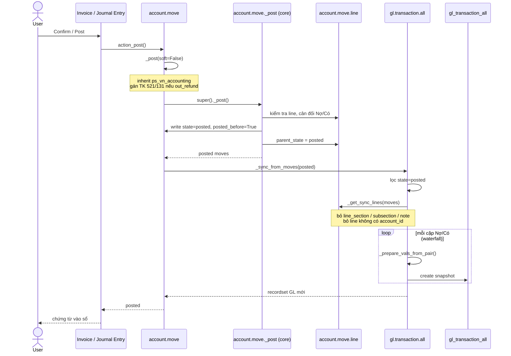
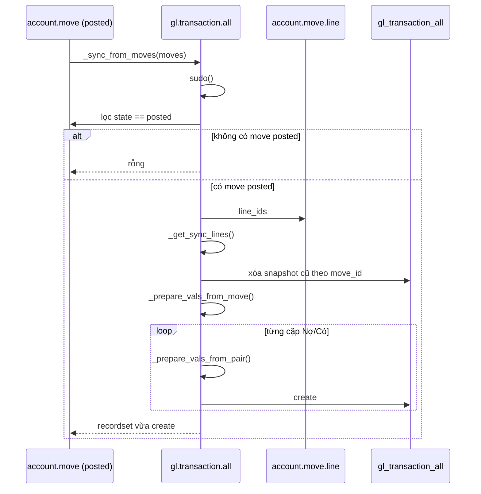
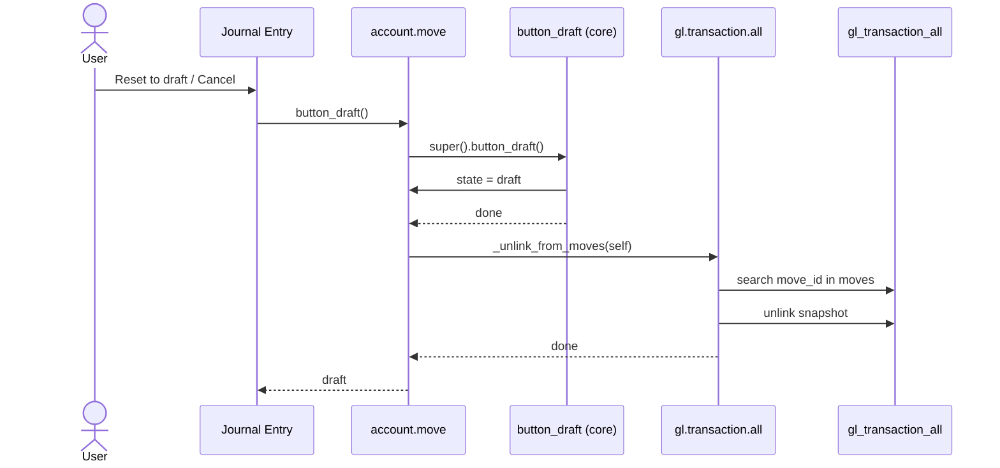
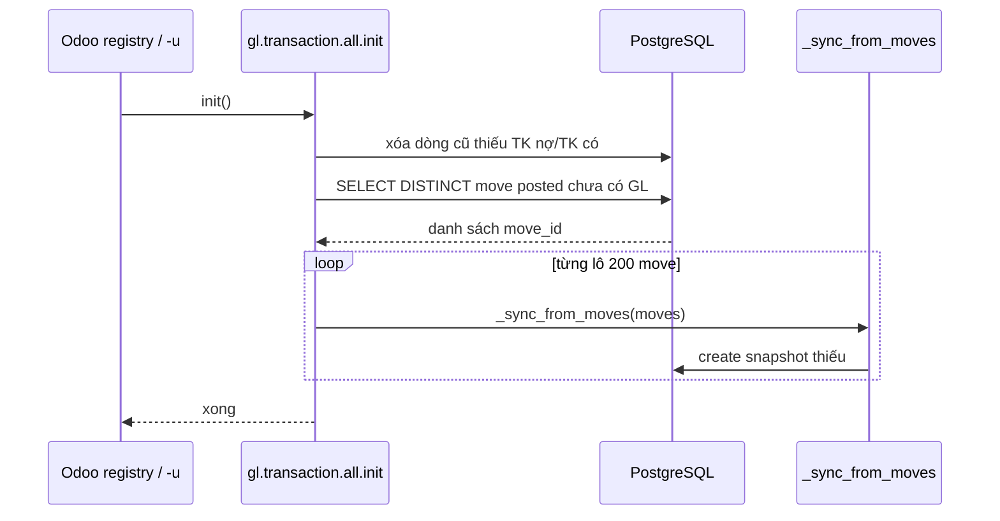
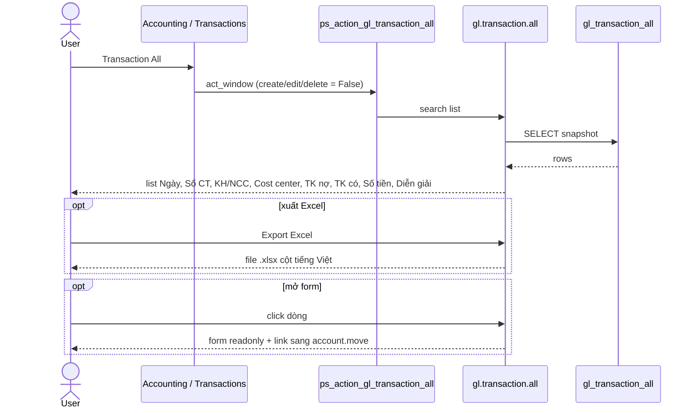
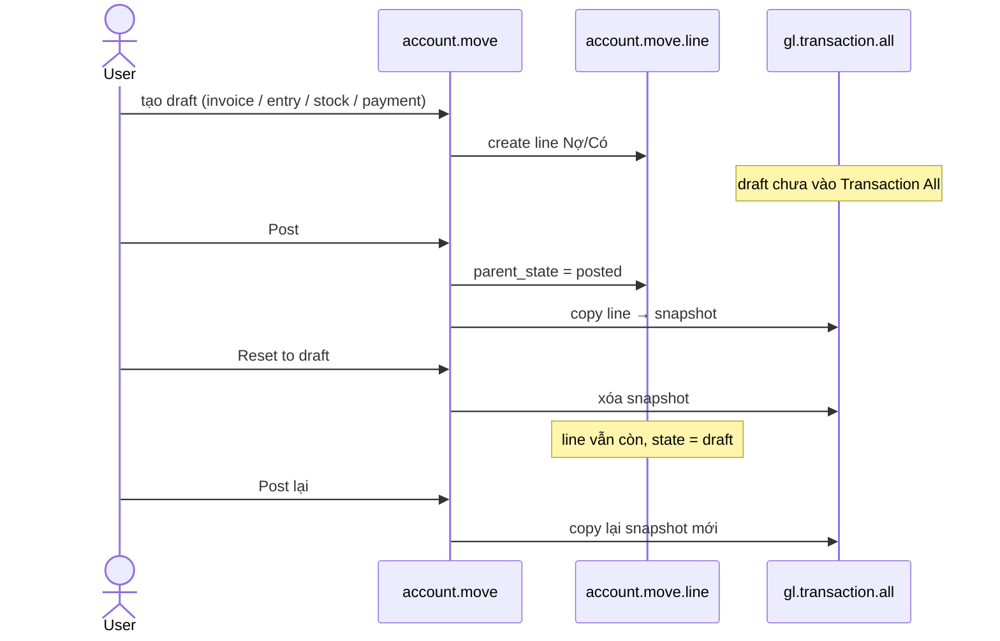

# Transaction All — luồng dữ liệu

`gl.transaction.all` là sổ nhật ký chung (snapshot) các bút toán **đã posted**, định dạng kế toán Việt Nam. Mỗi dòng là **một cặp Nợ/Có** (tài khoản nợ, tài khoản có, số tiền), không còn một dòng = một `account.move.line`.

Cột hiển thị: Ngày, Số chứng từ, Khách hàng/Nhà cung cấp, Cost center, Tài khoản nợ, Tài khoản có, Số tiền, Diễn giải. Nút **Xuất Excel** trên list xuất đúng các cột này.

Nguồn sự thật lúc tạo chứng từ vẫn là `account.move` / `account.move.line`. Bảng này chỉ nhận dữ liệu khi chứng từ vào sổ.

Menu: **Accounting → Transactions → Transaction All** (chỉ đọc).

File chính: `models/gl_transaction_all.py`.

## 1. Post — đưa bút toán vào sổ

Mọi sổ (hóa đơn, phiếu kho, tiền, misc…) đều đi qua `account.move._post()`. Hook copy chạy **sau** `super()._post()`, lúc `state = posted` và số chứng từ đã có.

Điểm móc:

| Bước | Hàm | Việc |
|---|---|---|
| Nút Post | `account.move.action_post()` | Gọi `_post(soft=False)` |
| Vào sổ Odoo | `account.move._post()` (core) | `state = posted` |
| Copy sang sổ VN | `gl.transaction.all._sync_from_moves()` | Xóa snapshot cũ của move, insert cặp Nợ/Có |
| Ghép Nợ-Có | `gl.transaction.all._iter_debit_credit_pairs()` | Waterfall theo số tiền còn lại |
| Map 1 cặp | `gl.transaction.all._prepare_vals_from_pair()` | Dict cột VN từ 2 AML |

Hóa đơn tương lai (`soft=True` và `date` > hôm nay) **chưa** vào Transaction All. Cron post thật sự xong mới copy.

## 2. Sync một chứng từ — chi tiết `_sync_from_moves`

Mỗi chứng từ posted được tạo lại toàn bộ cặp Nợ/Có. Unique theo `(debit_move_line_id, credit_move_line_id)`.

Ví dụ hóa đơn: Nợ 131 1.100, Có 511 1.000, Có 33311 100 → hai dòng GL: `131/511 = 1.000` và `131/33311 = 100`.

## 3. Reset draft / Cancel — ra khỏi sổ

`button_cancel()` của core gọi `button_draft()` với chứng từ posted, nên cancel cũng xóa snapshot.

Post lại sau draft: quay về luồng 1, copy mới.

Xóa chứng từ: `move_line_id` / `move_id` `ondelete=cascade` → snapshot bị xóa theo.

## 4. Backfill khi upgrade module

Chứng từ posted trước khi có feature này chưa có dòng GL. `init()` chạy lúc `-u ps_vn_accounting` (và khi load registry): tìm move posted còn thiếu snapshot, gọi lại `_sync_from_moves` từng lô 200.

## 5. Xem sổ (menu chỉ đọc)

Không tạo bút toán từ màn này. User chỉ đọc snapshot.

## 6. Toàn cảnh vòng đời một chứng từ

## Ghi chú

- Draft **không** vào Transaction All. Sổ này chỉ có bút toán đã vào sổ.
- Mọi journal đều vào chung một bảng (đúng nghĩa Transaction All).
- Custom cột VN sửa `_prepare_vals_from_pair()`. Hook `_post` giữ nguyên.
- User post không cần quyền create trên GL: `_sync_from_moves` chạy `sudo()`.
- Cost center lấy từ line Nợ, rồi line Có, rồi header chứng từ (`account.move.cost_center_id`).
