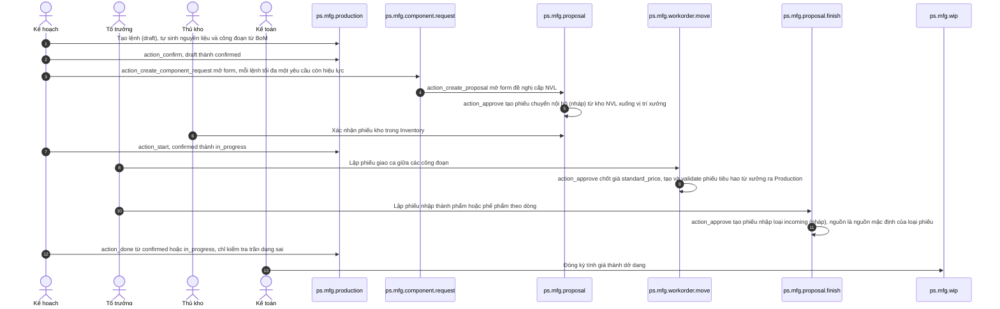
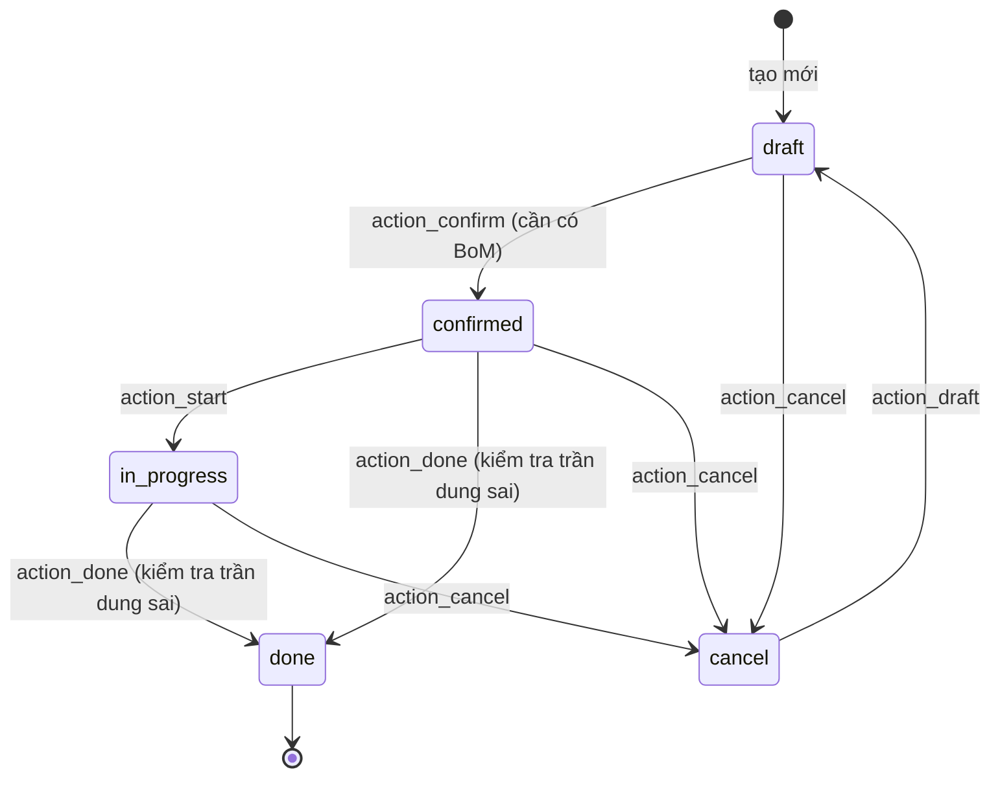

# Thiết kế: tách functional core cho Lệnh sản xuất (`ps.mfg.production`)

- **Phạm vi code:** `models/mfg_production.py`, thêm gói mới `ps_mfg/domain/`.
- **Tham chiếu:** `../specs/workorder-move.md`, `../specs/proposal-finish.md`, `models/mfg_wip.py`, `ps_approval/domain/` (cách làm mẫu), sách *Domain Modeling Made Functional* (Scott Wlaschin).
- **Thay thế:** bản này thay hướng của `design-pragmatic-fddd-production.md` ở phần lõi. Bản cũ giữ nguyên để đối chiếu.

## 0. Tóm tắt

Mình tách ba nhóm quy tắc của lệnh sản xuất ra Python thuần: dung sai sản lượng, vòng đời trạng thái, và (giai đoạn sau) kiểm tra hàng đã chạy hết các công đoạn. "Python thuần" nghĩa là không import `odoo`, không đọc ghi database, không tự lấy giờ hệ thống, nên test bằng `pytest` chạy trong vài chục mili-giây.

Phần lõi chỉ trả về **quyết định**: trạng thái mới, sản lượng chốt, hoặc lỗi. Phần Odoo bọc bên ngoài (gọi là *shell*) đọc dữ liệu, gọi lõi, rồi ghi database đúng một lần. Không có domain event (object "sự kiện" để nơi khác lắng nghe), không ghi chatter trong hàm compute.

Giai đoạn 1 **không đổi hành vi nào** mà người dùng thấy được. Mọi thay đổi hành vi được liệt kê riêng ở mục 11 và đều phải bật có chủ đích.

## 1. Mục tiêu và không làm

**Mục tiêu**

- Viết lại quy tắc dung sai và vòng đời lệnh thành hàm thuần, test được không cần Odoo.
- Giữ y hệt hành vi đang chạy, kể cả những chỗ hơi lạ (ví dụ `action_start` im lặng khi sai trạng thái).
- Dùng lại kiểu `Result` (`Ok`/`Err`) giống hệt `ps_approval/domain`, để hai module đọc code như nhau.
- Mỗi hàm action trong `mfg_production.py` còn khoảng 3 đến 8 dòng.

**Không làm**

- Không có domain event, không có "event bus", không `message_post` từ lõi. Chatter vẫn đến từ `tracking=True` như hiện tại.
- Không đụng các luồng yêu cầu cấp phát, đề nghị cấp NVL, phiếu giao ca, nhập thành phẩm, WIP. Mục 2 chỉ tả lại chúng để làm bối cảnh.
- Không bung BoM, không sinh công đoạn trong lõi. `_get_workorder_vals` dính `fields.Command` và dữ liệu routing, tách ra lời ít.
- Không gọi `ps_mfg` là "bounded context". Bounded context là một vùng nghiệp vụ có ranh giới riêng, bên ngoài không đụng thẳng vào dữ liệu. `ps_mfg` dùng chung database và khoá ngoại với kho, kế toán, bán hàng, nên không phải vậy.

## 2. Bối cảnh: luồng nghiệp vụ đang chạy

Phần này tả đúng code hiện tại, không phải đặc tả để làm lại. Chi tiết nằm trong các file doc tham chiếu.



Mấy điểm hay bị hiểu nhầm:

- Yêu cầu cấp phát (`ps.mfg.component.request`, YCCP) **không** tạo phiếu kho. Phiếu chuyển nội bộ chỉ sinh ra khi đề nghị `ps.mfg.proposal` được duyệt, và vẫn để nháp cho thủ kho xác nhận. Duyệt đề nghị cũng đẩy YCCP sang `approved`.
- Khi lệnh còn `confirmed`, sửa `product_qty` trên YCCP sẽ ghi ngược số lượng về lệnh, và danh sách nguyên liệu tính lại.
- Dòng nhập thành phẩm (`ps.mfg.proposal.finish.line`) nhận lệnh đang `in_progress`, công đoạn nào có `total_qty` (tổng đã nhận qua giao ca) lớn hơn 0 là được. Nó **không** đòi cờ `all_workorders_done`, **không** ghi `qty_produced` (sản lượng thực tế) và **không** đóng lệnh.
- Phiếu nhập thành phẩm là loại `incoming`, nguồn thường là Vendors, để nháp và không validate.
- Đóng kỳ WIP (`ps.mfg.wip`) lấy các dòng nhập thành phẩm đã duyệt có ngày chứng từ đến cuối kỳ, cộng `finish_qty` theo lệnh. Lệnh đã nằm ở WIP khác thì bỏ qua. `receipt_tran_cost` là tổng `amount_total` các phiếu giao ca đã duyệt của lệnh. `wip_value` (giá trị dở dang) chia cho các dòng theo trọng số là số lượng còn dở nhân giá dự toán `estimated_cost`. WIP không chờ lệnh `done`.

## 3. Vòng đời lệnh sản xuất (đúng như code hiện tại)



Bảng dưới là "hợp đồng" mà lõi phải giữ đúng. Cột cuối là cách xử lý khi gọi sai trạng thái.

| Hàm | Đi từ | Đi tới | Gọi sai trạng thái thì |
| --- | --- | --- | --- |
| `action_confirm` | `draft`, có `bom_id` | `confirmed` | Báo lỗi `UserError` |
| `action_start` | `confirmed` | `in_progress` | Im lặng, không làm gì |
| `action_done` | `confirmed`, `in_progress` | `done` | Báo lỗi `UserError` |
| `action_cancel` | mọi trạng thái trừ `done` | `cancel` | Lệnh `done` thì im lặng bỏ qua |
| `action_draft` | `cancel` | `draft` | Im lặng, không làm gì |

Khi đóng lệnh, nếu `qty_produced` đang trống hoặc bằng 0 thì lấy luôn `product_qty` (số lượng kế hoạch). Chỉ chặn khi sản lượng **vượt trần** `qty_tolerance_max`. Sàn `qty_tolerance_min` chỉ để hiển thị. Hủy lệnh không có lý do hủy và không kiểm tra đã nhập thành phẩm hay chưa.

## 4. Cách tách: lõi thuần và lớp Odoo bọc ngoài

Ý tưởng lấy từ *Domain Modeling Made Functional*, cũng là cách `ps_approval/domain` đang làm:

- **Functional core (lõi thuần):** hàm nhận dữ liệu thường (số, enum, dataclass), trả `Result`. Cùng đầu vào thì luôn cùng đầu ra.
- **Imperative shell (lớp bọc):** method Odoo đọc record, gọi lõi, đổi lỗi thành câu báo cho người dùng, rồi `write` một lần.
- **Trả quyết định, không trả sự kiện:** lõi trả `MoveTo(state)`, `Unchanged()` hoặc `DoneDecision(...)`. Shell nhìn kiểu dữ liệu mà làm, không cần bộ phát sự kiện.
- **Workflow là chuỗi bước:** mỗi bước trả `Ok` thì đi tiếp, gặp `Err` thì dừng luôn (gọi là *short-circuit*). Trong code, chuỗi này viết bằng `.map()` và `.flat_map()` của `Result`.
- **Làm trạng thái sai không thể biểu diễn, ở chỗ rẻ:** trạng thái là enum `ProductionState` chứ không phải chuỗi tuỳ ý. Dung sai đã kiểm tra hợp lệ là kiểu riêng `TolerancePct`, chỉ tạo qua `make_tolerance`. Mọi dataclass đều `frozen=True` (tạo xong không sửa được). Mình không đẩy xa hơn, ví dụ không làm mỗi trạng thái một class riêng, vì `state` trong Odoo vẫn là field selection.
- **Lỗi là dữ liệu, câu chữ ở shell:** lõi trả mã lỗi dạng enum. Shell giữ nguyên các câu `_("...")` hiện có, nhờ vậy công cụ trích chuỗi dịch vẫn thấy chúng.
- **Không tự lấy giờ:** shell truyền `now=fields.Datetime.now()` vào. Lõi không gọi `datetime.now()` hay `utcnow()`, nên test cố định được giờ.
- **So sánh số lượng do shell cung cấp:** trong Odoo 19, `uom.uom.compare()` và `is_zero()` làm tròn theo độ chính xác thập phân `Product Unit`. Lõi không tự viết lại thuật toán làm tròn của Odoo. Nó nhận một đối tượng có hai method đó (`QtyComparator`), và shell truyền thẳng `mo.product_uom_id` vào. Nhờ vậy kết quả trùng khớp tuyệt đối với code hiện tại.

## 5. Kiểu `Result`: dùng lại của `ps_approval`

`ps_approval/domain/result.py` định nghĩa `Ok`, `Err` với `is_ok()`, `is_err()`, `unwrap()`, `unwrap_err()`, `map()`, `flat_map()`, và `Result = Union[Ok, Err]`.

**`ps_mfg` hiện không phụ thuộc `ps_approval`.** `__manifest__.py` chỉ có `'depends': ['web', 'ps_stock', 'om_account_accountant', 'mail', 'sale']`. Có hai cách:

- **Cách A (đề xuất): chép nguyên file** sang `ps_mfg/domain/result.py`, không sửa một ký tự, đầu file ghi chú nguồn. File chỉ 55 dòng và hầu như không đổi. Cách này không bắt cài app duyệt cho mọi database có `ps_mfg`.
- **Cách B: thêm `'ps_approval'` vào `depends`.** Khó hơn bề ngoài. Trong Odoo, module được import với tên `odoo.addons.ps_approval`, còn khi chạy `pytest` thuần thì là `ps_approval`. Lõi muốn import thì phải `try/except` hai đường, mà như vậy lõi lại dính tên `odoo`. Chỉ nên chọn nếu sắp tới MFG cũng dùng luồng duyệt của `ps_approval`.

Nếu chọn A, thêm một test nhỏ so `inspect.getsource` của hai file để biết khi nào chúng lệch nhau (test bỏ qua nếu không thấy `ps_approval`).

## 6. Cấu trúc thư mục

```text
ps_mfg/
├── __init__.py              # sửa: chỉ import models/wizard/scripts khi có odoo
├── domain/                  # FUNCTIONAL CORE, không import odoo
│   ├── __init__.py
│   ├── result.py            # chép nguyên từ ps_approval/domain/result.py
│   ├── tolerance.py         # giai đoạn 1
│   ├── lifecycle.py         # giai đoạn 1
│   ├── drain.py             # giai đoạn 3
│   └── tests/               # pytest thuần
│       ├── __init__.py
│       ├── conftest.py
│       ├── test_tolerance.py
│       ├── test_lifecycle.py
│       └── test_drain.py
├── models/mfg_production.py # shell: sửa thân các method có sẵn
└── tests/                   # Odoo TransactionCase, giữ nguyên
```

**Tại sao test thuần nằm ở `domain/tests/` mà không phải `tests/test_domain_*.py`:** `ps_mfg/tests/__init__.py` import các test Odoo (`test_bom_copy`, ...), và khi `pytest` nạp `ps_mfg.tests.test_domain_x` thì nó chạy file `__init__.py` đó trước, nên sẽ lỗi vì không có `odoo`. Còn `domain/tests/` thì Odoo không quét tới (Odoo chỉ chạy `ps_mfg/tests`), mà `pytest` vẫn nạp được.

**Sửa `ps_mfg/__init__.py`** để `pytest` import được `ps_mfg.domain` mà không cần Odoo. Khi chạy trong Odoo thì kết quả y như cũ:

```python
from . import domain

try:
    import odoo  # noqa: F401
except ImportError:  # pure pytest, no Odoo on sys.path
    odoo = None

if odoo is not None:
    from . import models
    from . import wizard
    from . import scripts
```

Cách này khác `ps_approval` một chút. Bên đó bọc cả `from . import models` trong `try/except ImportError`, nên nếu model có lỗi import thật thì lỗi bị nuốt mất. Ở đây chỉ bắt lỗi khi import `odoo`.

## 7. `domain/tolerance.py`

Ba hàm, mỗi hàm khớp với một chỗ đang có trong `mfg_production.py`. `make_tolerance` khớp `_check_tolerance_values`, `compute_bounds` khớp `_compute_qty_tolerance_bounds`, còn `check_produced_qty` khớp `_check_qty_produced_tolerance`. Riêng `compute_bounds` nhận số thô, vì Odoo chạy compute trước constraint: lúc người dùng đang gõ dở một giá trị sai thì vẫn phải tính được biên.

```python
"""Tolerance rules for a manufacturing order. Pure Python, no Odoo import."""

from __future__ import annotations

from dataclasses import dataclass
from enum import Enum
from typing import Literal, Protocol

from .result import Err, Ok, Result


class QtyComparator(Protocol):
    """What the core needs to compare quantities.

    In Odoo the shell passes ``mo.product_uom_id`` itself: ``uom.uom`` already
    has ``compare`` and ``is_zero`` (Odoo 19 rounds with the 'Product Unit'
    decimal precision). The core never re-implements Odoo float rounding.
    """

    def compare(self, value1: float, value2: float) -> Literal[-1, 0, 1]: ...

    def is_zero(self, value: float) -> bool: ...


class ToleranceInputError(str, Enum):
    PLUS_NEGATIVE = "plus_negative"
    MINUS_NEGATIVE = "minus_negative"
    MINUS_ABOVE_100 = "minus_above_100"


@dataclass(frozen=True)
class TolerancePct:
    """A (+, -) tolerance pair that already passed validation.

    Build it only through ``make_tolerance``; holding one means it is valid.
    """

    plus: float
    minus: float


@dataclass(frozen=True)
class ToleranceBounds:
    min_qty: float
    max_qty: float


@dataclass(frozen=True)
class QtyAboveTolerance:
    produced_qty: float
    max_qty: float


def make_tolerance(
    plus: float, minus: float
) -> Result[TolerancePct, ToleranceInputError]:
    """Same checks, same order as ``_check_tolerance_values`` today."""
    plus = plus or 0.0
    minus = minus or 0.0
    if plus < 0.0:
        return Err(ToleranceInputError.PLUS_NEGATIVE)
    if minus < 0.0:
        return Err(ToleranceInputError.MINUS_NEGATIVE)
    if minus > 100.0:
        return Err(ToleranceInputError.MINUS_ABOVE_100)
    return Ok(TolerancePct(plus=plus, minus=minus))


def compute_bounds(product_qty: float, plus: float, minus: float) -> ToleranceBounds:
    """Same formula as ``_compute_qty_tolerance_bounds`` today.

    Takes raw floats on purpose: Odoo runs computes before constraints, so the
    bounds must still be computable while the user is typing a bad value.
    """
    qty = product_qty or 0.0
    min_qty = max(qty * (1.0 - (minus or 0.0) / 100.0), 0.0)
    max_qty = qty * (1.0 + (plus or 0.0) / 100.0)
    return ToleranceBounds(min_qty=min_qty, max_qty=max_qty)


def check_produced_qty(
    produced_qty: float,
    max_qty: float,
    qty_cmp: QtyComparator,
) -> Result[float, QtyAboveTolerance]:
    """Same rule as ``_check_qty_produced_tolerance``: only the ceiling is enforced."""
    if not produced_qty or qty_cmp.is_zero(produced_qty):
        return Ok(produced_qty)
    if qty_cmp.compare(produced_qty, max_qty) > 0:
        return Err(QtyAboveTolerance(produced_qty=produced_qty, max_qty=max_qty))
    return Ok(produced_qty)
```

## 8. `domain/lifecycle.py`

`mark_done` là ví dụ cho kiểu "chuỗi bước". Đầu tiên kiểm tra trạng thái, rồi chốt sản lượng, rồi kiểm tra trần dung sai, cuối cùng tạo quyết định. Bước nào ra `Err` thì các bước sau không chạy. `start(strict=True)` là chỗ bật hành vi mới có chủ đích (xem mục 11). Mặc định vẫn là `strict=False`, giữ y như hiện tại.

```python
"""Manufacturing order state machine. Pure Python, no Odoo import.

Every function returns a *decision*; the Odoo shell applies it with one write.
Behaviour mirrors models/mfg_production.py as of 2026-10 exactly.
"""

from __future__ import annotations

from dataclasses import dataclass
from datetime import datetime
from enum import Enum
from typing import Union

from .result import Err, Ok, Result
from .tolerance import QtyAboveTolerance, QtyComparator, check_produced_qty


class ProductionState(str, Enum):
    DRAFT = "draft"
    CONFIRMED = "confirmed"
    IN_PROGRESS = "in_progress"
    DONE = "done"
    CANCEL = "cancel"


# --- decisions -------------------------------------------------------------
@dataclass(frozen=True)
class MoveTo:
    """Write this new state."""

    state: ProductionState


@dataclass(frozen=True)
class Unchanged:
    """Do nothing (today's silent no-op for start/cancel/draft)."""


Transition = Union[MoveTo, Unchanged]


@dataclass(frozen=True)
class DoneDecision:
    qty_produced: float
    date_finished: datetime
    state: ProductionState = ProductionState.DONE


# --- errors ----------------------------------------------------------------
class LifecycleError(str, Enum):
    NOT_DRAFT = "not_draft"
    MISSING_BOM = "missing_bom"
    NOT_CONFIRMED = "not_confirmed"  # only with strict start (opt-in)
    NOT_CONFIRMED_OR_IN_PROGRESS = "not_confirmed_or_in_progress"


DoneError = Union[LifecycleError, QtyAboveTolerance]


# --- workflows -------------------------------------------------------------
def confirm(
    state: ProductionState, has_bom: bool
) -> Result[Transition, LifecycleError]:
    if state is not ProductionState.DRAFT:
        return Err(LifecycleError.NOT_DRAFT)
    if not has_bom:
        return Err(LifecycleError.MISSING_BOM)
    return Ok(MoveTo(ProductionState.CONFIRMED))


def start(
    state: ProductionState, strict: bool = False
) -> Result[Transition, LifecycleError]:
    """Today: silently ignored unless confirmed. ``strict=True`` is opt-in."""
    if state is ProductionState.CONFIRMED:
        return Ok(MoveTo(ProductionState.IN_PROGRESS))
    if strict:
        return Err(LifecycleError.NOT_CONFIRMED)
    return Ok(Unchanged())


def cancel(state: ProductionState) -> Result[Transition, LifecycleError]:
    """Today: anything but done goes to cancel; done is silently skipped."""
    if state is ProductionState.DONE:
        return Ok(Unchanged())
    return Ok(MoveTo(ProductionState.CANCEL))


def reset_to_draft(state: ProductionState) -> Result[Transition, LifecycleError]:
    if state is ProductionState.CANCEL:
        return Ok(MoveTo(ProductionState.DRAFT))
    return Ok(Unchanged())


def _check_can_finish(state: ProductionState) -> Result[ProductionState, DoneError]:
    if state in (ProductionState.CONFIRMED, ProductionState.IN_PROGRESS):
        return Ok(state)
    return Err(LifecycleError.NOT_CONFIRMED_OR_IN_PROGRESS)


def _finalize_qty(product_qty: float, qty_produced: float) -> float:
    """Empty produced qty means 'produced exactly as planned'."""
    return qty_produced if qty_produced else product_qty


def mark_done(
    state: ProductionState,
    product_qty: float,
    qty_produced: float,
    max_qty: float,
    qty_cmp: QtyComparator,
    now: datetime,
) -> Result[DoneDecision, DoneError]:
    """check state -> finalize qty -> check ceiling -> decision.

    Each step short-circuits on Err; nothing is written until the shell
    receives the final Ok.
    """
    return (
        _check_can_finish(state)
        .map(lambda _s: _finalize_qty(product_qty, qty_produced))
        .flat_map(lambda qty: check_produced_qty(qty, max_qty, qty_cmp))
        .map(lambda qty: DoneDecision(qty_produced=qty, date_finished=now))
    )
```

## 9. Shell: sửa trực tiếp `models/mfg_production.py`

Sửa ngay trong class `PsMfgProduction` hiện có, giữ `_name = 'ps.mfg.production'`, **không** tạo class `_inherit` mới. Thêm import ở đầu file:

```python
from ..domain import lifecycle, tolerance
from ..domain.lifecycle import LifecycleError, MoveTo, ProductionState
from ..domain.tolerance import QtyAboveTolerance, ToleranceInputError
```

Thay thân các method dưới đây, thêm ba method phụ, và **xoá** `_check_qty_produced_tolerance` (ngoài `action_done` không chỗ nào khác gọi nó). `_onchange_qty_produced_tolerance`, tức cảnh báo trên form, giữ nguyên.

```python
# ------------------------------------------------------------------
# Functional core adapters
# ------------------------------------------------------------------
def _domain_error_message(self, error):
    """Turn a core error into user text. Literals stay here for i18n."""
    if isinstance(error, QtyAboveTolerance):
        return _(
            "Produced quantity %(qty)s exceeds the allowed maximum %(max_qty)s "
            "(planned %(planned)s with +%(plus)s%% tolerance).",
            qty=error.produced_qty,
            max_qty=error.max_qty,
            planned=self.product_qty,
            plus=self.tolerance_plus,
        )
    messages = {
        ToleranceInputError.PLUS_NEGATIVE: _("The + tolerance (%) cannot be negative."),
        ToleranceInputError.MINUS_NEGATIVE: _(
            "The - tolerance (%) cannot be negative."
        ),
        ToleranceInputError.MINUS_ABOVE_100: _(
            "The - tolerance (%) cannot be greater than 100."
        ),
        LifecycleError.NOT_DRAFT: _(
            "Only draft manufacturing orders can be confirmed."
        ),
        LifecycleError.MISSING_BOM: _("Set a Bill of Materials before confirming."),
        LifecycleError.NOT_CONFIRMED: _(
            "Only confirmed manufacturing orders can be started."
        ),
        LifecycleError.NOT_CONFIRMED_OR_IN_PROGRESS: _(
            "Only confirmed or in-progress manufacturing orders can be marked as done."
        ),
    }
    return messages[error]


def _unwrap_or_raise(self, result, exc=UserError):
    if result.is_err():
        raise exc(self._domain_error_message(result.unwrap_err()))
    return result.unwrap()


def _apply_transition(self, transition):
    if isinstance(transition, MoveTo):
        self.write({"state": transition.state.value})


# ------------------------------------------------------------------
# Thin shell methods (replace the bodies of the existing ones)
# ------------------------------------------------------------------
@api.constrains("tolerance_plus", "tolerance_minus")
def _check_tolerance_values(self):
    for mo in self:
        mo._unwrap_or_raise(
            tolerance.make_tolerance(mo.tolerance_plus, mo.tolerance_minus),
            exc=ValidationError,
        )


@api.depends("product_qty", "tolerance_plus", "tolerance_minus")
def _compute_qty_tolerance_bounds(self):
    for mo in self:
        bounds = tolerance.compute_bounds(
            mo.product_qty, mo.tolerance_plus, mo.tolerance_minus
        )
        mo.qty_tolerance_min = bounds.min_qty
        mo.qty_tolerance_max = bounds.max_qty


def action_confirm(self):
    self.ensure_one()
    result = lifecycle.confirm(ProductionState(self.state), has_bom=bool(self.bom_id))
    self._apply_transition(self._unwrap_or_raise(result))


def action_start(self):
    self.ensure_one()
    result = lifecycle.start(ProductionState(self.state))  # strict=False: today's no-op
    self._apply_transition(self._unwrap_or_raise(result))


def action_done(self):
    self.ensure_one()
    decision = self._unwrap_or_raise(
        lifecycle.mark_done(
            ProductionState(self.state),
            product_qty=self.product_qty,
            qty_produced=self.qty_produced,
            max_qty=self.qty_tolerance_max,
            qty_cmp=self.product_uom_id,  # uom.uom has compare() / is_zero()
            now=fields.Datetime.now(),
        )
    )
    vals = {"state": decision.state.value, "date_finished": decision.date_finished}
    if decision.qty_produced != self.qty_produced:
        vals["qty_produced"] = decision.qty_produced
    self.write(vals)  # one write, nothing before it


def action_cancel(self):
    self.ensure_one()
    self._apply_transition(
        self._unwrap_or_raise(lifecycle.cancel(ProductionState(self.state)))
    )


def action_draft(self):
    self.ensure_one()
    self._apply_transition(
        self._unwrap_or_raise(lifecycle.reset_to_draft(ProductionState(self.state)))
    )
```

Vài chỗ cần để ý:

- `action_done` ghi trạng thái, ngày xong và (nếu đổi) sản lượng trong **một** lệnh `write`. Code cũ gán `qty_produced` trước rồi mới kiểm tra dung sai. Nếu lỗi thì transaction bị rollback, nên kết quả trong database như nhau.
- `qty_cmp=self.product_uom_id` dùng được vì `uom.uom` có sẵn `compare()` và `is_zero()`, đúng như `QtyComparator` cần.
- Lỗi của `_check_tolerance_values` vẫn ra `ValidationError`, lỗi của action vẫn ra `UserError`, câu chữ giữ nguyên từng ký tự.

## 10. Test thuần

Chạy từ thư mục `odoo-dev`. Venv hiện tại chưa có `pytest`, nên dùng `uv run --with pytest` hoặc cài thêm `pytest` làm dev dependency:

```bash
uv run --with pytest pytest -q custom_addons/odoo-mfg/ps_mfg/domain/tests
```

`conftest.py` có một bộ so sánh giả, làm tròn kiểu thập phân, để test không cần Odoo. Cách làm tròn thật của Odoo thì giao cho test `TransactionCase` kiểm, không kiểm ở đây.

```python
from decimal import ROUND_HALF_UP, Decimal

import pytest


class DigitsComparator:
    """Test double for uom.uom compare/is_zero at N decimal digits.

    Close to Odoo float_compare(precision_digits=N) for normal values; the
    real Odoo rounding is covered by the TransactionCase tests, not here.
    """

    def __init__(self, digits: int = 4):
        self._q = Decimal(1).scaleb(-digits)

    def _round(self, value: float) -> Decimal:
        return Decimal(repr(value)).quantize(self._q, rounding=ROUND_HALF_UP)

    def compare(self, value1, value2):
        a, b = self._round(value1), self._round(value2)
        return (a > b) - (a < b)

    def is_zero(self, value):
        return self._round(value) == 0


@pytest.fixture
def qty_cmp():
    return DigitsComparator(digits=4)
```

`test_tolerance.py` viết cùng kiểu, mỗi nhánh một case: từng mã lỗi của `make_tolerance` (kể cả thứ tự kiểm tra khi cả hai số đều âm), biên khi `minus` bằng 100, sàn 0 của `compute_bounds`, và `check_produced_qty` với số vừa chạm trần, vượt trần, bằng 0, hay dưới sàn (dưới sàn vẫn `Ok`). Ví dụ đầy đủ là `test_lifecycle.py`:

```python
from datetime import datetime

import pytest

from ps_mfg.domain.lifecycle import (
    DoneDecision,
    LifecycleError,
    MoveTo,
    ProductionState as S,
    Unchanged,
    cancel,
    confirm,
    mark_done,
    reset_to_draft,
    start,
)
from ps_mfg.domain.result import Err, Ok
from ps_mfg.domain.tolerance import QtyAboveTolerance

NOW = datetime(2026, 10, 29, 8, 0, 0)


def test_confirm():
    assert confirm(S.DRAFT, has_bom=True) == Ok(MoveTo(S.CONFIRMED))
    assert confirm(S.DRAFT, has_bom=False) == Err(LifecycleError.MISSING_BOM)
    assert confirm(S.CONFIRMED, has_bom=True) == Err(LifecycleError.NOT_DRAFT)


@pytest.mark.parametrize("state", [S.DRAFT, S.IN_PROGRESS, S.DONE, S.CANCEL])
def test_start_is_silent_noop_unless_confirmed(state):
    assert start(state) == Ok(Unchanged())
    assert start(state, strict=True) == Err(LifecycleError.NOT_CONFIRMED)


def test_start_from_confirmed():
    assert start(S.CONFIRMED) == Ok(MoveTo(S.IN_PROGRESS))


def test_cancel_and_reset():
    assert cancel(S.DONE) == Ok(Unchanged())
    for state in (S.DRAFT, S.CONFIRMED, S.IN_PROGRESS, S.CANCEL):
        assert cancel(state) == Ok(MoveTo(S.CANCEL))
    assert reset_to_draft(S.CANCEL) == Ok(MoveTo(S.DRAFT))
    assert reset_to_draft(S.DONE) == Ok(Unchanged())


def test_done_from_confirmed_uses_planned_qty(qty_cmp):
    res = mark_done(S.CONFIRMED, 100.0, 0.0, 105.0, qty_cmp, NOW)
    assert res == Ok(DoneDecision(qty_produced=100.0, date_finished=NOW))


def test_done_keeps_entered_qty(qty_cmp):
    res = mark_done(S.IN_PROGRESS, 100.0, 104.0, 105.0, qty_cmp, NOW)
    assert res.unwrap().qty_produced == 104.0


def test_done_short_circuits(qty_cmp):
    assert mark_done(S.DRAFT, 100.0, 0.0, 105.0, qty_cmp, NOW) == Err(
        LifecycleError.NOT_CONFIRMED_OR_IN_PROGRESS
    )
    assert mark_done(S.IN_PROGRESS, 100.0, 106.0, 105.0, qty_cmp, NOW) == Err(
        QtyAboveTolerance(produced_qty=106.0, max_qty=105.0)
    )
```

Ngoài test thuần, thêm vào `tests/` một `TransactionCase` nhỏ (ví dụ `test_production_lifecycle.py`) bấm `action_confirm`, `action_start`, `action_done`, `action_cancel`, `action_draft` trên record thật. Test này chạy với **code cũ trước**, ghi lại kết quả, rồi chạy lại sau khi tách lõi. Kết quả khác nhau tức là có thay đổi hành vi ngoài ý muốn.

## 11. Thay đổi hành vi

**Giai đoạn 1 và 2: không có.** Trạng thái, câu báo lỗi, loại exception và giá trị ghi xuống database giữ y như cũ. Chỉ có hai khác biệt kỹ thuật, người dùng không thấy được: `action_done` gộp còn một lệnh `write`, và `ps_mfg/__init__.py` thêm điều kiện khi import.

**Chỉ bật khi được đồng ý, mỗi cái một thay đổi riêng:**

1. `action_start` báo lỗi khi lệnh không ở `confirmed`. Cách bật là gọi `lifecycle.start(..., strict=True)` trong shell. Nút trên view hiện chỉ hiện khi đúng trạng thái, nhưng script `scripts/feed_demo_data.py` và các test có gọi `action_start()`, nên phải chạy lại hết.
2. (Giai đoạn 3) Cờ `all_workorders_done` được tính lại khi hủy YCCP. Đây là sửa lỗi, xem mục 12.

Những ý trong bản thiết kế cũ như chặn hủy khi đã nhập thành phẩm, thêm `cancel_reason`, hay kiểm tra sàn dung sai khi đóng lệnh **không** nằm trong bản này. Muốn làm thì tách thành yêu cầu riêng.

## 12. Giai đoạn 3: kiểm tra hàng đã chạy hết công đoạn (`drain.py`)

"Drain" ở đây nghĩa là toàn bộ số lượng mục tiêu (số lượng trên YCCP còn hiệu lực) đã được giao qua hết mọi công đoạn, theo thứ tự `sequence`, chỉ tính các phiếu giao ca đã duyệt. Hàm lõi trả về `bool` và không làm gì khác. Phép so sánh do shell truyền vào, giữ đúng `float_compare(..., precision_digits=6)` như hiện tại.

```python
"""Phase 3: has the target qty flowed through every work order? Pure Python."""

from __future__ import annotations

from collections import defaultdict
from dataclasses import dataclass
from typing import Callable, Sequence

QtyCompare = Callable[[float, float], int]


@dataclass(frozen=True)
class ApprovedMove:
    """One approved shift handover. ``from_wo_id`` is 0 for the first stage."""

    from_wo_id: int
    to_wo_id: int
    qty: float


def is_pipeline_drained(
    target_qty: float,
    ordered_wo_ids: Sequence[int],
    approved_moves: Sequence[ApprovedMove],
    compare: QtyCompare,
) -> bool:
    """Same rule as ``_compute_all_workorders_done`` today (state check stays in shell)."""
    if not target_qty or not ordered_wo_ids:
        return False
    qty_in: dict[int, float] = defaultdict(float)
    qty_pair: dict[tuple[int, int], float] = defaultdict(float)
    for move in approved_moves:
        qty_in[move.to_wo_id] += move.qty
        qty_pair[(move.from_wo_id, move.to_wo_id)] += move.qty
    prev = 0
    for wo_id in ordered_wo_ids:
        available = target_qty if not prev else qty_in.get(prev, 0.0)
        moved = qty_pair.get((prev, wo_id), 0.0)
        if compare(moved, available) < 0:
            return False
        prev = wo_id
    return True
```

Phía shell, compute chỉ gán field, không ghi chatter và không ghi gì khác. Cùng lúc đó sửa một lỗi có sẵn: danh sách `@api.depends` (các field mà compute theo dõi để tự tính lại) thiếu `component_request_ids.state`. Vì vậy hiện giờ hủy YCCP xong thì cờ không được tính lại. Dòng đánh dấu `NEW` là phần thay đổi hành vi duy nhất của giai đoạn này. Bỏ thêm lệnh `search` thừa, đọc thẳng `component_request_ids`. Cần import `ApprovedMove` và `is_pipeline_drained` từ `..domain.drain`.

```python
@api.depends(
    "state",
    "workorder_ids.sequence",
    "workorder_ids.move_ids.state",
    "workorder_ids.move_ids.move_qty",
    "workorder_ids.move_ids.from_workorder_id",
    "workorder_ids.move_ids.to_workorder_id",
    "component_request_ids.product_qty",
    "component_request_ids.state",
)  # NEW: cancelling a YCCP recomputes
def _compute_all_workorders_done(self):
    for mo in self:
        wos = mo.workorder_ids.sorted("sequence")
        if mo.state != "in_progress" or not wos:
            mo.all_workorders_done = False
            continue
        request = mo.component_request_ids.filtered(lambda r: r.state != "cancelled")[
            :1
        ]
        moves = [
            ApprovedMove(m.from_workorder_id.id or 0, m.to_workorder_id.id, m.move_qty)
            for m in mo.workorder_ids.move_ids
            if m.state == "approved"
        ]
        mo.all_workorders_done = is_pipeline_drained(
            request.product_qty or 0.0,
            wos.ids,
            moves,
            compare=lambda a, b: float_compare(a, b, precision_digits=6),
        )
```

`ps.mfg.workorder.move._get_available_qty` cũng đang tính "số lượng có sẵn cho công đoạn" theo cùng quy tắc. Sau giai đoạn 3 có thể cho nó gọi chung một hàm lõi, nhưng đó là việc riêng, cần test `test_workorder_move.py` đi kèm.

## 13. Lộ trình

| Giai đoạn | Việc | Đổi hành vi | Kiểm chứng |
| --- | --- | --- | --- |
| 0 | Viết `TransactionCase` cho vòng đời lệnh, chạy trên code cũ | Không | Test xanh trên code cũ |
| 1 | `domain/result.py`, `tolerance.py`, `lifecycle.py`, test thuần, sửa `__init__.py`, đổi thân các method ở mục 9 | Không | `pytest` thuần, test giai đoạn 0, `-u ps_mfg` với `--test-tags /ps_mfg` |
| 2 | Dọn dẹp: bỏ code chết, ghi lại quyết định trong `AGENTS.md` của module | Không | Như giai đoạn 1 |
| 3 | `drain.py`, đổi `_compute_all_workorders_done`, thêm depends `component_request_ids.state` | Có, sửa lỗi | Thêm test hủy YCCP, chạy `TestMfgProposalFinish`, `TestMfgWorkorderMove` |
| Tùy chọn | `start(strict=True)` | Có | Sửa `feed_demo_data.py` và các test gọi `action_start` |

Mỗi giai đoạn là một commit (hoặc PR) riêng, để dễ revert.

## 14. Hiệu quả và giới hạn

Phần lõi nhỏ, chừng 150 dòng, nhưng đây đúng là chỗ có nhiều nhánh `if` dễ sửa nhầm: dung sai, điều kiện chuyển trạng thái, công thức drain. Test thuần phủ hết mọi nhánh đó trong vài chục mili-giây, còn `TransactionCase` mỗi lần chạy mất cả phút.

Lõi **không** kiểm chứng được những phần tốn công và dễ sai nhất của module: bung BoM, sinh công đoạn và snapshot resource, chọn lot trên phiếu giao ca, tạo phiếu kho, phân bổ WIP. Những phần đó vẫn cần test Odoo. Nếu sau này muốn tách tiếp, ứng viên hợp lý là phép chia `_split_amount` trong `mfg_wip.py` (đã gần như thuần) và `_get_available_qty` của phiếu giao ca.
