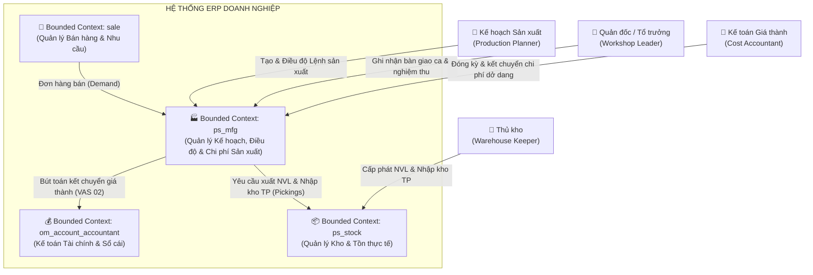
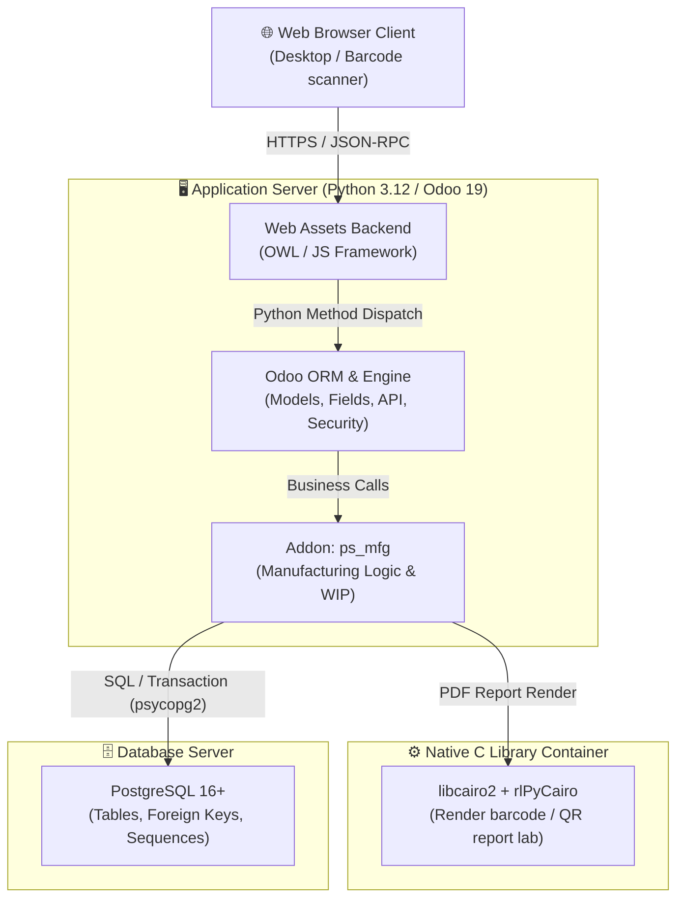
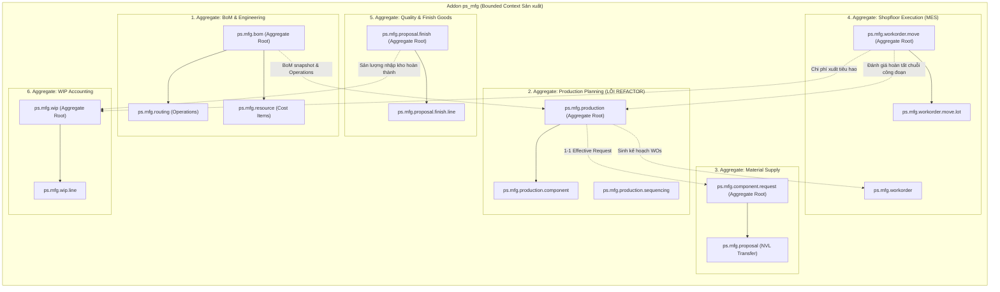
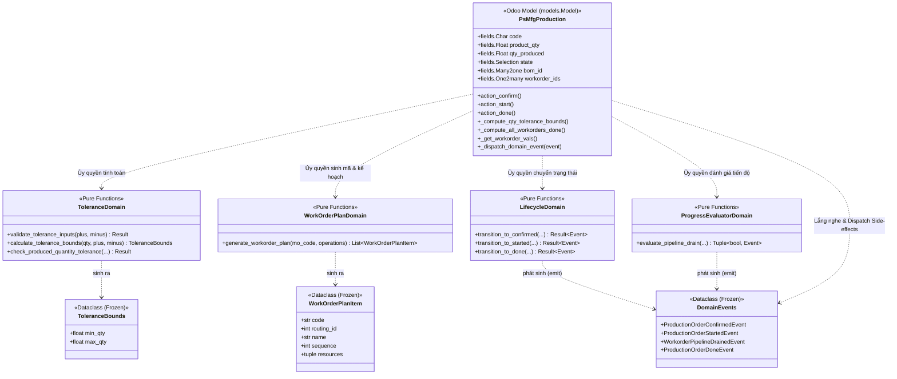
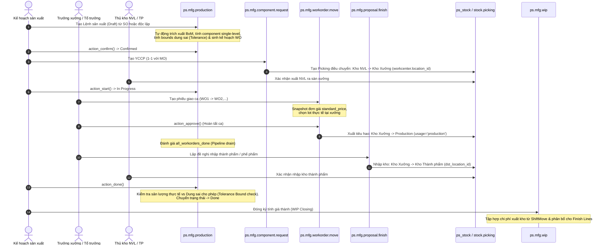
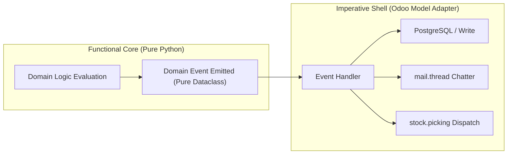
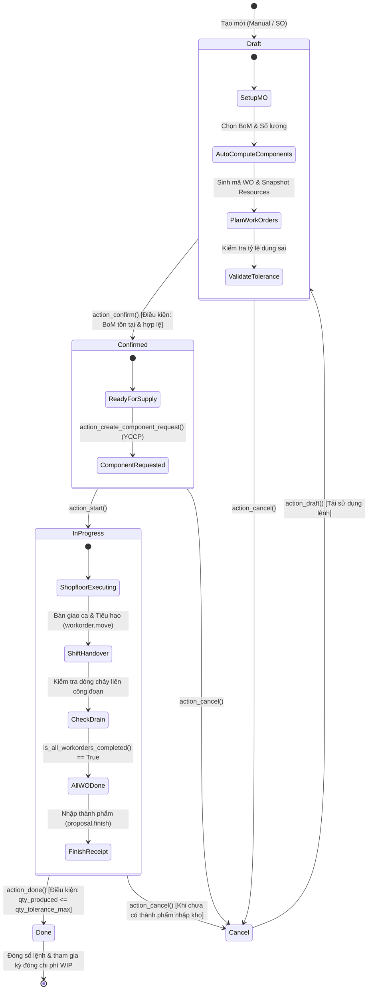

# BẢN THIẾT KẾ CHI TIẾT: ÁP DỤNG PRAGMATIC fDDD CHO MODULE MFG_PRODUCTION
## (MÔ HÌNH HÓA C4: TỔNG QUAN ĐẾN CHI TIẾT, AGGREGATES & DOMAIN EVENTS)

- **Tệp nguồn mục tiêu:** [`custom_addons/odoo-mfg/ps_mfg/models/mfg_production.py`](file:///home/thachnguyen/Projects/work/erp/odoo/odoo-dev/custom_addons/odoo-mfg/ps_mfg/models/mfg_production.py)
- **Tài liệu tham chiếu liên quan:** [`../specs/bom.md`](file:///home/thachnguyen/Projects/work/erp/odoo/odoo-dev/custom_addons/odoo-mfg/ps_mfg/../specs/bom.md), [`../specs/workorder-move.md`](file:///home/thachnguyen/Projects/work/erp/odoo/odoo-dev/custom_addons/odoo-mfg/ps_mfg/../specs/workorder-move.md), [`../specs/proposal-finish.md`](file:///home/thachnguyen/Projects/work/erp/odoo/odoo-dev/custom_addons/odoo-mfg/ps_mfg/../specs/proposal-finish.md)
- **Mô hình kiến trúc:** Pragmatic fDDD (Functional Core, Imperative Shell - FCIS) kết hợp C4 Model để phân rã kiến trúc trực quan từ vĩ mô đến vi mô.

---

## 1. MÔ HÌNH HÓA KIẾN TRÚC THEO C4 (TỪ TỔNG QUAN ĐẾN CHI TIẾT)

Để tránh việc nhồi nhét tất cả các thành phần vào một biểu đồ khổng lồ gây khó đọc, kiến trúc được phân tách thành **4 cấp độ C4** rõ ràng:
* **C4 Level 1 (System Context):** Bối cảnh hệ thống — Ai sử dụng và tương tác với các Bounded Contexts nào?
* **C4 Level 2 (Container):** Các khối runtime & triển khai vật lý — Web Client, Odoo Application Server, PostgreSQL, C Native worker.
* **C4 Level 3 (Component):** Phân rã nội bộ module `ps_mfg` thành các Aggregates và các khối chức năng.
* **C4 Level 4 (Code / Class):** Đi sâu vào cấu trúc mã nguồn của `mfg_production.py` và gói `domain/` theo Pragmatic fDDD.

---

### 1.1. C4 Level 1: System Context Diagram (Bối cảnh Hệ thống)

Cấp độ này thể hiện người dùng nghiệp vụ và mối quan hệ giữa **Bounded Context `ps_mfg`** với các Bounded Contexts lân cận trong hệ thống ERP:



---

### 1.2. C4 Level 2: Container Diagram (Kiến trúc Runtime & Containers)

Cấp độ này mô tả các khối công nghệ triển khai thực tế của module trong môi trường Odoo:



---

### 1.3. C4 Level 3: Component Diagram (Nội bộ Bounded Context `ps_mfg`)

Cấp độ này phóng to vào bên trong **Addon `ps_mfg`**, thể hiện rõ các **Aggregates (Cụm thực thể)** và ranh giới trách nhiệm của từng khối:



---

### 1.4. C4 Level 4: Code Diagram (Đi sâu vào `mfg_production.py` theo Pragmatic fDDD)

Cấp độ này đi thẳng vào chi tiết cấu trúc mã nguồn của **Lệnh sản xuất (`ps.mfg.production`)**, phân định rạch ròi giữa **Functional Core (Pure Python)** và **Imperative Shell (Odoo Model Adapter)**:



---

## 2. QUY TRÌNH NGHIỆP VỤ TỔNG THỂ (END-TO-END WORKFLOW)

Quy trình luân chuyển chứng từ và dòng chảy vật tư giữa các Aggregates:



---

## 3. DOMAIN EVENTS ARCHITECTURE (KIẾN TRÚC SỰ KIỆN MIỀN)

Trong mô hình Pragmatic fDDD, các **Domain Events** được phát sinh dưới dạng các đối tượng dữ liệu thuần túy (Pure Dataclass) từ Functional Core khi có thay đổi trạng thái hoặc hoàn tất tính toán. Imperative Shell sẽ lắng nghe các events này để thực hiện các side-effects (ghi DB, gửi thông báo chatter, trigger picking).



### Danh mục Domain Events chính trong `mfg_production`:

| Domain Event | Khi nào phát sinh? | Payload (Dữ liệu mang theo) | Phản ứng của Imperative Shell |
| :--- | :--- | :--- | :--- |
| **`ProductionOrderConfirmedEvent`** | Khi MO chuyển từ `draft` sang `confirmed`. | `mo_id`, `mo_code`, `product_id`, `planned_qty`, `bom_id`, `timestamp` | Ghi state `confirmed`, ghi nhận log chatter, mở quyền tạo YCCP. |
| **`ProductionOrderStartedEvent`** | Khi MO chuyển từ `confirmed` sang `in_progress`. | `mo_id`, `mo_code`, `timestamp` | Ghi state `in_progress`, kích hoạt theo dõi tiến độ trên Gantt/Dashboard. |
| **`ToleranceBoundExceededEvent`** | Khi sản lượng thực tế nhập kho vượt ngưỡng dung sai max. | `mo_id`, `actual_qty`, `max_allowed_qty`, `diff_qty` | Raise `UserError` chặn thao tác hoàn tất, hoặc gửi cảnh báo warning UI. |
| **`WorkorderPipelineDrainedEvent`** | Khi toàn bộ vật tư mục tiêu đã di chuyển hết qua toàn bộ chuỗi công đoạn. | `mo_id`, `target_qty`, `total_wos`, `timestamp` | Cập nhật trường `all_workorders_done = True` trên MO. |
| **`ProductionOrderDoneEvent`** | Khi MO đóng hoàn tất. | `mo_id`, `qty_produced`, `date_finished` | Ghi state `done`, set `date_finished = now()`, khóa mọi thay đổi trên MO. |
| **`ProductionOrderCancelledEvent`** | Khi MO bị hủy. | `mo_id`, `cancel_reason`, `timestamp` | Ghi state `cancel`, ghi chú lý do vào chatter. |

---

## 4. BIỂU ĐỒ TRẠNG THÁI CHI TIẾT (STATE MACHINE DIAGRAM)

Vòng đời của một Lệnh sản xuất (`ps.mfg.production`) và các điều kiện kích hoạt chuyển trạng thái:



---

## 5. THIẾT KẾ CẤU TRÚC FUNCTIONAL CORE (FCIS)

Để hiện thực hóa Pragmatic fDDD, cấu trúc mã nguồn được phân lớp sạch sẽ:

```text
ps_mfg/
├── domain/                               <-- FUNCTIONAL CORE (Pure Python, Zero Odoo Import)
│   ├── __init__.py
│   ├── types.py                          # Kiểu dữ liệu bất biến (DTOs, Result, Enums)
│   ├── events.py                         # Định nghĩa các Domain Events (Pure Dataclasses)
│   ├── tolerance.py                      # Nghiệp vụ dung sai & Kiểm tra biên độ sản lượng
│   ├── workorder_plan.py                 # Quy hoạch công đoạn, sinh mã, xử lý trùng mã suffix (-2, -3)
│   ├── progress_evaluator.py             # Thuật toán đánh giá hoàn tất chuỗi công đoạn (Pipeline)
│   └── lifecycle.py                      # Máy trạng thái (State invariants & Event generation)
├── models/                               <-- IMPERATIVE SHELL (Odoo ORM Adapter)
│   ├── mfg_production.py                 # Adapter mỏng: Đọc DB -> Gọi Core -> Xử lý Events & DB Write
│   └── ...
└── tests/
    ├── test_domain_pure/                 # Pytest thuần (chạy độc lập, siêu tốc < 50ms)
    │   ├── test_tolerance.py
    │   ├── test_workorder_plan.py
    │   ├── test_progress_evaluator.py
    │   ├── test_lifecycle.py
    │   └── test_events.py
    └── test_odoo/                        # Odoo TransactionCase kiểm tra tích hợp DB/View
```

---

## 6. ĐẶC TẢ CHI TIẾT CÁC MODULE DOMAIN

### 6.1. `domain/events.py`: Định nghĩa Domain Events

```python
"""Domain Events for ps_mfg production lifecycle. Pure Python dataclasses."""

from dataclasses import dataclass
from datetime import datetime
from typing import Optional


@dataclass(frozen=True)
class DomainEvent:
    occurred_at: datetime


@dataclass(frozen=True)
class ProductionOrderConfirmedEvent(DomainEvent):
    mo_id: int
    mo_code: str
    product_id: int
    planned_qty: float
    bom_id: int


@dataclass(frozen=True)
class ProductionOrderStartedEvent(DomainEvent):
    mo_id: int
    mo_code: str


@dataclass(frozen=True)
class ProductionOrderDoneEvent(DomainEvent):
    mo_id: int
    qty_produced: float
    date_finished: datetime


@dataclass(frozen=True)
class ToleranceBoundExceededEvent(DomainEvent):
    mo_id: int
    actual_qty: float
    max_allowed_qty: float
    diff_qty: float


@dataclass(frozen=True)
class WorkorderPipelineDrainedEvent(DomainEvent):
    mo_id: int
    target_qty: float
```

---

### 6.2. `domain/tolerance.py`: Quản lý Dung sai & Giới hạn Sản lượng

```python
"""Pure domain functions for Tolerance logic."""

from typing import Optional
from datetime import datetime
from .types import ToleranceBounds, Result
from .events import ToleranceBoundExceededEvent


def validate_tolerance_inputs(plus_pct: float, minus_pct: float) -> Result[None, str]:
    if plus_pct < 0.0:
        return Result.fail("The + tolerance (%) cannot be negative.")
    if minus_pct < 0.0:
        return Result.fail("The - tolerance (%) cannot be negative.")
    if minus_pct > 100.0:
        return Result.fail("The - tolerance (%) cannot be greater than 100.")
    return Result.ok(None)


def calculate_tolerance_bounds(
    product_qty: float, plus_pct: float, minus_pct: float
) -> ToleranceBounds:
    qty = max(product_qty or 0.0, 0.0)
    p_pct = plus_pct or 0.0
    m_pct = minus_pct or 0.0

    min_allowed = max(qty * (1.0 - m_pct / 100.0), 0.0)
    max_allowed = qty * (1.0 + p_pct / 100.0)
    return ToleranceBounds(min_qty=min_allowed, max_qty=max_allowed)


def check_produced_quantity_tolerance(
    mo_id: int, qty_produced: float, max_allowed_qty: float, precision_digits: int = 4
) -> Result[Optional[ToleranceBoundExceededEvent], str]:
    """Kiểm tra sản lượng thực tế. Nếu vượt, trả về lỗi hoặc sinh Event tương ứng."""
    if not qty_produced or qty_produced <= 0.0:
        return Result.ok(None)

    diff = round(qty_produced - max_allowed_qty, precision_digits)
    if diff > 0:
        event = ToleranceBoundExceededEvent(
            occurred_at=datetime.utcnow(),
            mo_id=mo_id,
            actual_qty=qty_produced,
            max_allowed_qty=max_allowed_qty,
            diff_qty=diff,
        )
        return Result.fail(
            f"Produced quantity {qty_produced} exceeds allowed maximum {max_allowed_qty}."
        )
    return Result.ok(None)
```

---

### 6.3. `domain/progress_evaluator.py`: Đánh giá Tiến độ Liên công đoạn

```python
"""Pure domain evaluator for production pipeline completion."""

from typing import Sequence, Optional, Tuple
from collections import defaultdict
from datetime import datetime
from .types import MoveSnapshot
from .events import WorkorderPipelineDrainedEvent


def evaluate_pipeline_drain(
    mo_id: int,
    target_qty: float,
    ordered_wo_ids: Sequence[int],
    approved_moves: Sequence[MoveSnapshot],
    tolerance_epsilon: float = 1e-6,
) -> Tuple[bool, Optional[WorkorderPipelineDrainedEvent]]:
    """Kiểm tra toàn bộ số lượng mục tiêu đã được chuyển giao hoàn tất qua từng chặng."""
    if target_qty <= 0.0 or not ordered_wo_ids:
        return False, None

    qty_in = defaultdict(float)  # to_wo_id -> tổng nhận
    qty_pair = defaultdict(float)  # (from_wo_id, to_wo_id) -> tổng chuyển của cặp

    for m in approved_moves:
        qty_in[m.to_wo_id] += m.qty
        qty_pair[(m.from_wo_id, m.to_wo_id)] += m.qty

    prev_wo_id = 0
    for wo_id in ordered_wo_ids:
        available = target_qty if prev_wo_id == 0 else qty_in.get(prev_wo_id, 0.0)
        moved = qty_pair.get((prev_wo_id, wo_id), 0.0)

        if (available - moved) > tolerance_epsilon:
            return False, None

        prev_wo_id = wo_id

    event = WorkorderPipelineDrainedEvent(
        occurred_at=datetime.utcnow(), mo_id=mo_id, target_qty=target_qty
    )
    return True, event
```

---

### 6.4. `domain/lifecycle.py`: State Transitions & Event Dispatch

```python
"""Pure domain state machine and event emitter for MO lifecycle."""

from datetime import datetime
from typing import Tuple, Optional
from .types import ProductionState, Result
from .events import (
    ProductionOrderConfirmedEvent,
    ProductionOrderStartedEvent,
    ProductionOrderDoneEvent,
)


def transition_to_confirmed(
    mo_id: int,
    mo_code: str,
    product_id: int,
    planned_qty: float,
    bom_id: int,
    current_state: str,
) -> Result[ProductionOrderConfirmedEvent, str]:
    if current_state != ProductionState.DRAFT.value:
        return Result.fail("Only draft manufacturing orders can be confirmed.")
    if not bom_id:
        return Result.fail("Set a Bill of Materials before confirming.")

    event = ProductionOrderConfirmedEvent(
        occurred_at=datetime.utcnow(),
        mo_id=mo_id,
        mo_code=mo_code,
        product_id=product_id,
        planned_qty=planned_qty,
        bom_id=bom_id,
    )
    return Result.ok(event)


def transition_to_started(
    mo_id: int, mo_code: str, current_state: str
) -> Result[ProductionOrderStartedEvent, str]:
    if current_state != ProductionState.CONFIRMED.value:
        return Result.fail("Only confirmed manufacturing orders can be started.")

    event = ProductionOrderStartedEvent(
        occurred_at=datetime.utcnow(), mo_id=mo_id, mo_code=mo_code
    )
    return Result.ok(event)


def transition_to_done(
    mo_id: int, planned_qty: float, current_produced_qty: float, current_state: str
) -> Result[Tuple[float, ProductionOrderDoneEvent], str]:
    if current_state not in (
        ProductionState.CONFIRMED.value,
        ProductionState.IN_PROGRESS.value,
    ):
        return Result.fail(
            "Only confirmed or in-progress manufacturing orders can be marked as done."
        )

    final_qty = (
        current_produced_qty
        if current_produced_qty and current_produced_qty > 0
        else planned_qty
    )
    now = datetime.utcnow()

    event = ProductionOrderDoneEvent(
        occurred_at=now, mo_id=mo_id, qty_produced=final_qty, date_finished=now
    )
    return Result.ok((final_qty, event))
```

---

## 7. HIỆN THỰC HÓA IMPERATIVE SHELL (`models/mfg_production.py`)

Imperative Shell nhận các Domain Events từ Core để điều phối các hành động nghiệp vụ Odoo:

```python
from odoo import models, fields, api, _
from odoo.exceptions import UserError, ValidationError

from ..domain.tolerance import (
    validate_tolerance_inputs,
    calculate_tolerance_bounds,
    check_produced_quantity_tolerance,
)
from ..domain.workorder_plan import generate_workorder_plan
from ..domain.progress_evaluator import evaluate_pipeline_drain
from ..domain.lifecycle import (
    transition_to_confirmed,
    transition_to_started,
    transition_to_done,
)
from ..domain.types import RoutingOperationSpec, RoutingResourceSpec, MoveSnapshot


class PsMfgProduction(models.Model):
    _inherit = "ps.mfg.production"

    # -------------------------------------------------------------------------
    # DOMAIN EVENT DISPATCHER (SHELL INFRASTRUCTURE)
    # -------------------------------------------------------------------------
    def _dispatch_domain_event(self, event):
        """Xử lý side-effects tương ứng với từng Domain Event."""
        if not event:
            return

        # Ghi chú chatter tự động theo sự kiện miền
        if event.__class__.__name__ == "ProductionOrderConfirmedEvent":
            self.message_post(
                body=_("Lệnh sản xuất đã xác nhận với BoM ID: %s", event.bom_id)
            )
        elif event.__class__.__name__ == "WorkorderPipelineDrainedEvent":
            self.message_post(
                body=_(
                    "Toàn bộ sản lượng mục tiêu (%s) đã hoàn tất luân chuyển qua tất cả công đoạn.",
                    event.target_qty,
                )
            )
        elif event.__class__.__name__ == "ProductionOrderDoneEvent":
            self.message_post(
                body=_(
                    "Lệnh sản xuất đã đóng hoàn tất với sản lượng: %s",
                    event.qty_produced,
                )
            )

    # -------------------------------------------------------------------------
    # ADAPTER METHODS
    # -------------------------------------------------------------------------
    @api.constrains("tolerance_plus", "tolerance_minus")
    def _check_tolerance_values(self):
        for mo in self:
            res = validate_tolerance_inputs(mo.tolerance_plus, mo.tolerance_minus)
            if not res.success:
                raise ValidationError(_(res.error))

    @api.depends("product_qty", "tolerance_plus", "tolerance_minus")
    def _compute_qty_tolerance_bounds(self):
        for mo in self:
            bounds = calculate_tolerance_bounds(
                mo.product_qty, mo.tolerance_plus, mo.tolerance_minus
            )
            mo.qty_tolerance_min = bounds.min_qty
            mo.qty_tolerance_max = bounds.max_qty

    @api.depends(
        "state",
        "workorder_ids.sequence",
        "workorder_ids.move_ids.state",
        "workorder_ids.move_ids.move_qty",
        "workorder_ids.move_ids.from_workorder_id",
        "workorder_ids.move_ids.to_workorder_id",
        "component_request_ids.product_qty",
    )
    def _compute_all_workorders_done(self):
        for mo in self:
            wos = mo.workorder_ids.sorted("sequence")
            if mo.state != "in_progress" or not wos:
                mo.all_workorders_done = False
                continue

            cmp_request = self.env["ps.mfg.component.request"].search(
                [("production_id", "=", mo.id), ("state", "!=", "cancelled")], limit=1
            )
            target = cmp_request.product_qty or 0.0

            moves = [
                MoveSnapshot(
                    from_wo_id=m.from_workorder_id.id or 0,
                    to_wo_id=m.to_workorder_id.id,
                    qty=m.move_qty,
                )
                for m in mo.workorder_ids.move_ids
                if m.state == "approved"
            ]

            done, event = evaluate_pipeline_drain(mo.id, target, wos.ids, moves)
            mo.all_workorders_done = done
            if event:
                mo._dispatch_domain_event(event)

    def action_confirm(self):
        self.ensure_one()
        res = transition_to_confirmed(
            mo_id=self.id,
            mo_code=self.code,
            product_id=self.product_id.id,
            planned_qty=self.product_qty,
            bom_id=self.bom_id.id,
            current_state=self.state,
        )
        if not res.success:
            raise UserError(_(res.error))

        self.state = "confirmed"
        self._dispatch_domain_event(res.value)

    def action_start(self):
        self.ensure_one()
        res = transition_to_started(self.id, self.code, self.state)
        if not res.success:
            raise UserError(_(res.error))

        self.state = "in_progress"
        self._dispatch_domain_event(res.value)

    def action_done(self):
        self.ensure_one()
        res = transition_to_done(
            self.id, self.product_qty, self.qty_produced, self.state
        )
        if not res.success:
            raise UserError(_(res.error))

        final_qty, event = res.value
        self.qty_produced = final_qty

        # Kiểm tra dung sai
        tol_check = check_produced_quantity_tolerance(
            self.id, self.qty_produced, self.qty_tolerance_max
        )
        if not tol_check.success:
            raise UserError(
                _(
                    "Produced quantity %(qty)s exceeds the allowed maximum %(max_qty)s "
                    "(planned %(planned)s with +%(plus)s%% tolerance).",
                    qty=self.qty_produced,
                    max_qty=self.qty_tolerance_max,
                    planned=self.product_qty,
                    plus=self.tolerance_plus,
                )
            )

        self.write({"state": "done", "date_finished": fields.Datetime.now()})
        self._dispatch_domain_event(event)
```

---

## 8. LỢI ÍCH KIẾN TRÚC VÀ TỔNG KẾT

1. **Trực quan hóa đa tầng theo C4:** Giúp các bên liên quan (từ PM, BA đến Developers) dễ dàng theo dõi hệ thống từ tổng quan vĩ mô (System Context) đến từng class/hàm cụ thể (Code level) mà không bị "ngợp" thông tin.
2. **Phân rã rõ ràng ranh giới Aggregates:** Module `ps_mfg` là một Bounded Context duy nhất chứa các Aggregates độc lập (`BoM`, `MO`, `WorkorderMove`, `ProposalFinish`, `WIP`), giải quyết triệt để sự nhập nhằng thuật ngữ.
3. **Event Choreography minh bạch:** Sự kiện miền (`DomainEvent`) trở thành "hợp đồng" chuẩn mực để đồng bộ trạng thái giữa các Aggregates và các Bounded Context lân cận.
4. **Thử nghiệm đơn vị không phụ thuộc Odoo:** Các kịch bản chuyển đổi trạng thái phức tạp, dung sai, tắc nghẽn công đoạn có thể được kiểm thử 100% tự động bằng `pytest` thuần chỉ trong **vài phần nghìn giây**.
5. **An toàn tuyệt đối cho hệ thống đang chạy:** 100% tương thích ngược với Database, Views XML và các module phụ thuộc như `ps_stock` và `om_account_accountant`.
