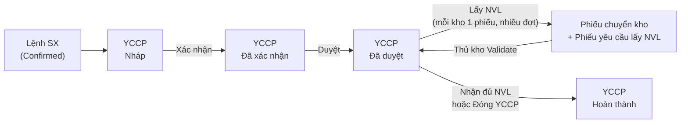

# Lấy NVL theo kho nguồn (Component pick)

Quy trình cấp NVL từ kho về xưởng dựa trên **Yêu cầu vật tư (YCCP –
`ps.mfg.component.request`)**. Nhân viên xưởng chọn các NVL nằm cùng một
kho, hệ thống tạo phiếu chuyển kho nội bộ và in **Phiếu yêu cầu lấy NVL** để
mang xuống kho. Quy trình này **thay thế Proposal NVL (`ps.mfg.proposal`)**;
Proposal cũ chỉ còn để tra cứu.

> Không liên quan tới Phiếu nhập thành phẩm (`ps.mfg.proposal.finish`) –
> xem [proposal-finish.md](proposal-finish.md).

---

## Phần 1 – Hướng dẫn sử dụng

### 1.1. Tổng quan luồng

| Vai trò | Việc cần làm |
|---|---|
| Nhân viên xưởng | Lập YCCP, chọn kho nguồn, lấy NVL theo từng kho, in phiếu |
| Quản lý | Duyệt YCCP, đóng YCCP khi chấp nhận thiếu |
| Thủ kho | Xuất hàng theo phiếu, Validate phiếu chuyển kho |

### 1.2. Chuẩn bị YCCP

1. Vào **Patsoft MFG → Sản xuất → Yêu cầu vật tư** → **Mới**.
2. Chọn **Lệnh sản xuất** (chỉ hiện MO đã xác nhận). Số lượng SP được lấy từ MO;
   các dòng NVL tự sinh theo BoM.
3. Chọn **kho nguồn mặc định** ở header (Component Source). Mọi dòng NVL lấy
   kho này làm mặc định.
4. Ở tab **Vật tư**, nếu NVL nào nằm ở kho khác thì **đổi Kho nguồn trên
   từng dòng**.
   - Dòng sinh từ BoM **không xóa được**; có thể thêm dòng NVL phát sinh bằng
     *Add a line* (dòng thêm tay thì xóa được).
   - Kho nguồn không được trùng kho xưởng (kho đích).
5. Bấm **Xác nhận**, sau đó quản lý bấm **Duyệt**.
   Từ lúc **Đã duyệt**, YCCP và các dòng NVL bị khóa (chỉ còn sửa được
   **SL lấy đợt này**, xem bên dưới).

> Có thể bấm Xác nhận ngay khi đang sửa dở: form tự lưu, các thay đổi trên
> dòng (kho nguồn, số lượng) được giữ nguyên.

### 1.3. Lấy NVL theo kho

1. Mở YCCP **Đã duyệt** → bấm smart button **Lấy NVL** (góc trên form).
   Nút chỉ hiện khi YCCP đã duyệt **và** còn NVL chưa cấp.
2. Danh sách dòng NVL mở ra, **group theo kho nguồn**, mặc định lọc
   **Còn lại cần lấy** (ẩn dòng đã cấp đủ). Có thể group thêm theo Công đoạn.
3. Ở cột **SL lấy đợt này**, sửa số lượng muốn lấy (mặc định = số lượng còn
   lại). Muốn lấy nhiều đợt thì nhập ít hơn số còn lại.
4. **Tick chọn** các dòng NVL **cùng một kho** cần đi lấy.
5. Bấm **Tạo phiếu & In** (nút xuất hiện trên đầu danh sách khi có dòng được
   chọn). Hệ thống:
   - tạo **1 phiếu chuyển kho nội bộ cho mỗi kho nguồn** (nếu lỡ chọn dòng ở
     nhiều kho thì sẽ ra nhiều phiếu), từ kho nguồn → kho xưởng;
   - xác nhận phiếu và giữ hàng (reserve) nếu kho có tồn;
   - ghi chú vào chatter của YCCP;
   - mở **Phiếu yêu cầu lấy NVL** để in.
6. Bấm **F5 / tải lại** danh sách để thấy số lượng cập nhật.

### 1.4. Phiếu yêu cầu lấy NVL

Mỗi phiếu chuyển kho in ra 1 trang gồm:

- Tiêu đề **PHIẾU YÊU CẦU LẤY NGUYÊN VẬT LIỆU**, ngày, mã QR = số phiếu kho.
- Số phiếu kho, mã YCCP, Lệnh SX, Xưởng SX, Kho xuất → Kho nhận.
- Bảng NVL: STT, Mã NVL, Tên NVL, ĐVT, **SL yêu cầu**, **SL thực xuất** (để
  trống – thủ kho ghi tay), Ghi chú.
- Chữ ký: Người yêu cầu – Thủ kho – Người nhận.

Phiếu hiển thị dạng HTML trên trình duyệt → dùng **Ctrl+P** để in.

**In lại**:
- Trong danh sách **Lấy NVL**, bấm **In phiếu lấy NVL** (luôn hiện):
  - có tick dòng → lấy phiếu của các dòng đó; không tick dòng nào → lấy
    **toàn bộ** phiếu của YCCP (kể cả khi đã lấy hết, danh sách trống do
    filter "Còn lại cần lấy"). Phiếu đã hủy bị bỏ qua.
  - Chỉ có **1 phiếu** → in luôn.
  - **Nhiều phiếu** → mở danh sách **Chọn phiếu lấy NVL để in**: bấm **In** trên
    từng dòng, hoặc tick nhiều phiếu rồi bấm **In phiếu đã chọn**.
  - In nhiều phiếu cùng lúc: mỗi phiếu ra 1 trang riêng (trên màn hình có
    đường gạch ngăn cách).
- Hoặc mở phiếu chuyển kho (Inventory, hoặc smart button **Phiếu chuyển kho**
  trên YCCP) → **Print → Phiếu yêu cầu lấy NVL**.

### 1.5. Thủ kho xuất hàng

1. Mở phiếu chuyển nội bộ tương ứng (quét QR / tìm theo số phiếu, nguồn =
   mã YCCP) trong **Inventory**.
2. Nhập số lượng thực giao cho từng NVL → **Validate**.
3. Giao thiếu: Odoo hỏi tạo **backorder** (phần còn lại vẫn chờ giao) hoặc
   **không tạo backorder** (phần thiếu được trả lại YCCP để lấy đợt sau).
4. Hủy phiếu: số lượng của phiếu được trả lại YCCP, có thể lấy lại.

### 1.6. Theo dõi số lượng

Trên từng dòng NVL luôn có:
**Kế hoạch = Đã chuyển + Đang chờ chuyển + Còn lại**.

| Cột (giao diện) | Ý nghĩa |
|---|---|
| Planned Quantity | SL NVL cần theo kế hoạch (theo BoM × SL sản xuất) |
| Số lượng đã chuyển | SL đã nhận về xưởng (phiếu đã Validate, trừ hàng trả lại kho) |
| Số lượng đang đề xuất | SL đang nằm trên phiếu chuyển chưa hoàn tất |
| Còn lại | SL chưa được lấy, có thể lấy ở đợt sau |
| SL lấy đợt này | SL sẽ lấy ở lần bấm "Tạo phiếu & In" kế tiếp |

**Trạng thái chuyển kho** của YCCP: *Chưa cấp* → *Đã cấp một phần* →
*Đã cấp đủ*. Khi mọi dòng nhận đủ, YCCP **tự chuyển Hoàn thành**.
Nếu chấp nhận nhận thiếu, quản lý bấm **Đóng YCCP** (chỉ khi không còn phiếu
đang chờ chuyển).

### 1.7. Câu hỏi thường gặp

| Hiện tượng | Nguyên nhân / Cách xử lý |
|---|---|
| Không thấy nút **Lấy NVL** | YCCP chưa Duyệt, đã cấp đủ / đang chờ chuyển hết, hoặc là YCCP cũ (legacy) |
| Lỗi "SL lấy … không được vượt quá SL còn lại" | Giảm SL lấy đợt này; phần còn lại có thể đang nằm trên phiếu chưa Validate |
| Lỗi "Chỉ được lấy NVL cho yêu cầu cấp phát đã duyệt" | Duyệt YCCP trước |
| Không sửa được dòng NVL | YCCP đã duyệt/hoàn thành/hủy (chỉ sửa được SL lấy đợt này), hoặc tài khoản chưa có quyền ghi |
| Nút **Tạo phiếu & In** không hiện | Chưa tick dòng nào |
| Lỗi "Chưa có phiếu lấy NVL nào để in." | Chưa tạo phiếu nào (hoặc mọi phiếu đã hủy) |
| Tìm Proposal NVL cũ | Smart button Proposals trên YCCP; menu Proposals chỉ hiện ở **Developer mode** |

---

## Phần 2 – Technical notes (handover)

### Files

- `models/mfg_component_request.py` – header `action_open_pick_lines`; line
  `qty_to_pick`, `_compute_quantities`, `_check_pickable`,
  `_get_internal_picking_type`, `action_create_pick_transfer`.
- `views/ps_mfg_component_request_views.xml` – stat button
  `action_open_pick_lines`; `ps_mfg_component_request_line_view_list_pick`
  (editable, `<header>` button), `ps_mfg_component_request_line_view_search_pick`
  (`remaining` filter, `group_location`).
- `report/ps_mfg_component_pick_report.xml` – `action_report_component_pick`
  (`qweb-html`, bound to `stock.picking`), template
  `report_component_pick_document`.
- `models/stock_picking.py` – `_action_done` → `_check_transfer_complete`
  (unchanged, auto-done).
- `tests/test_component_request_pick.py` (`TestComponentRequestPick`,
  post_install).

### Quantities

`qty_planned = qty_transferred + qty_open + qty_to_propose`

- `qty_transferred`: done moves on `move_ids` (via
  `stock.move.component_request_line_id`) minus return moves.
- `qty_open`: `product_uom_qty` of moves not in `done/cancel` and not returns,
  **plus** `qty_to_transfer` of legacy proposal lines whose proposal is
  `pending` (approved proposals already have moves → not double counted).
  No longer reads `proposal_line.qty_open`.
- `qty_to_pick`: stored compute, `readonly=False`, depends on
  `qty_to_propose` → resets to remaining after each pick / cancel.

### Locking

`LINE_LOCK_ALLOWED_FIELDS = {"qty_to_pick"}`: line `write()` skips
`_check_request_not_locked` only when vals touch nothing else. Header lock
(`LOCKED_STATES`) unchanged.

### `action_create_pick_transfer` (runs on selected lines)

1. Keep lines with `qty_to_pick > 0`, else `UserError`.
2. `_check_pickable`: request `approved`, not `legacy_transfer`;
   `qty_to_pick <= qty_to_propose + 1e-4`; destination set.
3. Group by `(request_id, location_id)` → one `stock.picking` each; type
   `location.warehouse_id.int_type_id`, fallback internal type of the company;
   `origin = request.code`; moves carry `component_request_line_id`.
4. `pickings.action_confirm()`, chatter on the request.
5. `report_action(pickings)` with `discard_logo_check=True` (template does not
   use `external_layout`; avoids the admin "configure document layout" wizard).

### `action_print_pick_request` (reprint)

List header button with `display="always"`, so it runs with an empty
recordset when nothing is selected. Selected lines → their pickings;
empty → all lines of the request from context `pick_request_id` (set by
`action_open_pick_lines`). Cancelled pickings are skipped. One picking →
report directly; several → act_window on `stock.picking` with
`stock_picking_view_list_component_pick` (row + header button
`stock.picking.action_print_component_pick`) so the user chooses.
The template inserts a page break between pickings (`o_last`).

### Legacy proposal (`ps.mfg.proposal`)

Kept read-only for history: list/form `create="0"`, menu
`groups="base.group_no_one"`, "Create Proposal" header button removed
(`action_create_proposal` kept for old tests). Draft/pending proposals can
still be approved/rejected. Do not re-enable without asking.

### Pitfalls (don't regress)

1. **`component_line_ids` must stay `readonly=False`.** It is a stored
   `precompute=True` compute; Odoo 19 `_prepare_create_values` discards
   client values of *readonly* precomputed fields on create
   (`odoo/orm/models.py`, "discard precomputed readonly fields") and
   regenerates lines from the BoM → unsaved line edits (source location, qty,
   manual lines) were lost on Save/Confirm of a new request. Locking is done
   by `is_readonly` (view) + `_check_request_not_locked` (server).
2. **`is_from_bom` needs `force_save="1"`** in the request form's line list.
   It is readonly, so the web client does not send it; without force_save BoM
   lines are created with `is_from_bom=False` and the delete icon shows.
   Covered by `test_form_line_location_kept_on_confirm`.
3. Don't `t-set="request"` in QWeb — shadows the global HTTP `request`; the
   report uses `comp_req`.
4. **Moves are not merged across request lines.** `stock.move`
   `_prepare_merge_moves_distinct_fields` includes
   `component_request_line_id` / `proposal_line_id`. Without it, two lines of
   the same product (e.g. one BoM component used at two work orders) picked
   from the same source merge into one move, the second line keeps
   `qty_transferred = 0` and blocks the workorder move of its WO.
   Covered by `test_same_product_lines_not_merged_on_pick`.
5. List `<header>` button returning a report action does not reload the list;
   accepted (user refreshes).

### Known gaps

- ACL: `base.group_user` has read-only access on
  `ps.mfg.component.request.line`; only `base.group_system` can write /
  create pickings. A workshop group is not defined yet.
- Report is `qweb-html` (no wkhtmltopdf in the dev env), like the MO report.
- Pre-existing failing tests (sale order, WIP figures) are unrelated to this
  feature. Fixtures that feed workorder moves use
  `tests/common.create_received_component_request` (approve + pick + receive).
