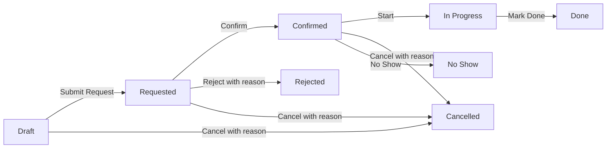

# Appointment Management

Phân hệ **Appointment Management** cho Odoo 19 Community: tiếp nhận và xếp lịch hẹn theo dịch vụ, nhân viên, giờ làm và phòng/thiết bị.

| Thông tin | Giá trị |
|---|---|
| Tên ứng dụng | Appointment Management |
| Tên kỹ thuật | `ps_appointment` |
| Thư mục trong dự án Odoo | `custom_addons/ps_appointment/` |
| Phụ thuộc bắt buộc | `base`, `mail`, `web` |
| Địa chỉ Odoo mẫu | `http://localhost:8570` |

## Tính năng

- Khai báo loại lịch hẹn, thời lượng, thời gian đệm, mức phí, hạn đặt trước, nhân viên/nhóm được phép nhận và nguồn lực phù hợp.
- Khai báo lịch làm việc theo thứ trong tuần, giờ nghỉ, ngày nghỉ theo nhân viên hoặc nguồn lực; tính thời gian theo múi giờ người dùng/công ty.
- Tạo các khung giờ còn trống theo dịch vụ và lịch nhân viên; sinh lại cùng khoảng ngày không tạo trùng.
- Ghi nhận khách hàng, nhân viên phụ trách, phòng/thiết bị, ghi chú và chứng từ liên quan.
- Kiểm tra giờ làm, thời gian báo trước, hạn đặt lịch, ngày nghỉ, lịch trùng của nhân viên/nguồn lực và khung giờ đã đặt. Khóa các dòng dịch vụ/nhân viên/nguồn lực trong lúc xác nhận để tuần tự hóa thao tác đặt đồng thời.
- Theo dõi thay đổi trên chatter và nhật ký bất biến qua giao diện thông thường.
- Lập lịch email nhắc tự động, ghi nhận trạng thái gửi; tác vụ kiểm tra gửi mỗi 15 phút. Email chỉ được xếp vào hàng đợi Odoo nếu khách hàng có địa chỉ email và cấu hình gửi thư hoạt động.
- Tổng quan theo khoảng ngày: số lượng trạng thái, tỷ lệ vắng mặt và tỷ lệ sử dụng khung giờ đã sinh. Có danh sách, kanban, lịch, biểu đồ, pivot và báo cáo PDF.
- Tạo liên kết Calendar, Sales Order hoặc Field Service task khi ứng dụng và model tương ứng đã được cài. Nhân viên có thể liên kết hồ sơ Employee khi HR đã được cài. Các liên kết này không phải phụ thuộc bắt buộc.
- Hỗ trợ nhiều công ty và phân quyền theo nhóm.

## Quy trình



Khi yêu cầu được gửi, hệ thống tự chọn nhân viên và nguồn lực phù hợp nếu chưa được chọn. Yêu cầu và lịch hẹn đã xác nhận đều chiếm chỗ; hoàn thành, từ chối, hủy hoặc đánh dấu vắng mặt sẽ giải phóng đặt chỗ. Người dùng phải nhập lý do trước khi từ chối hoặc hủy.

## Vai trò

| Nhóm | Quyền chính |
|---|---|
| Appointment User | Tạo/yêu cầu lịch hẹn, quản lý hồ sơ do mình tạo hoặc được giao |
| Appointment Receptionist | Xem và xử lý lịch hẹn trong công ty, từ chối, hủy hoặc đánh dấu vắng mặt |
| Appointment Manager | Xác nhận, quản lý dịch vụ/nguồn lực/lịch/ngày nghỉ và tạo khung giờ |
| Appointment Administrator | Toàn quyền quản trị cấu hình Appointment |

Gán nhóm tại **Cài đặt → Người dùng & Công ty → Người dùng**. Nhân viên được phân công cần là người dùng nội bộ Odoo đang hoạt động.

## Chạy tuần tự

Mở PowerShell trong thư mục `odoo-trien-khai` (nơi có `docker-compose.yml`), sau đó chạy:

1. Khởi động Odoo và PostgreSQL:

   ```powershell
   docker compose up -d
   docker compose ps
   ```

2. Cài addon vào database `admin`:

   ```powershell
   docker compose run --rm --no-deps -T --entrypoint sh odoo -c 'odoo -c /etc/odoo/odoo.conf --db_host="$HOST" --db_port="$PORT" --db_user="$USER" --db_password="$PASSWORD" -d admin -i ps_appointment --stop-after-init'
   docker compose start odoo
   ```

3. Mở `http://localhost:8570`, đăng nhập và gán nhóm **Appointment Administrator** cho người quản trị tại trang người dùng.

4. Mở ứng dụng **Appointments**. Tạo service type, thêm nhân viên và nguồn lực, khai báo lịch làm việc/ngày nghỉ, rồi chọn **Generate Availability** để sinh khung giờ.

5. Tạo lịch hẹn, chọn thời gian hoặc khung giờ rồi **Submit Request**. Appointment Manager xác nhận yêu cầu; sau đó nhân viên bắt đầu và hoàn tất lịch.

### Cập nhật addon

Sau khi sửa mã nguồn, trong cùng thư mục chạy:

```powershell
docker compose stop odoo
docker compose run --rm --no-deps -T --entrypoint sh odoo -c 'odoo -c /etc/odoo/odoo.conf --db_host="$HOST" --db_port="$PORT" --db_user="$USER" --db_password="$PASSWORD" -d admin -u ps_appointment --stop-after-init'
docker compose start odoo
```

### Chạy kiểm thử

```powershell
docker compose stop odoo
docker compose run --rm --no-deps -T --entrypoint sh odoo -c 'odoo -c /etc/odoo/odoo.conf --db_host="$HOST" --db_port="$PORT" --db_user="$USER" --db_password="$PASSWORD" -d admin -u ps_appointment --test-enable --test-tags /ps_appointment --stop-after-init'
docker compose start odoo
```

Lệnh kiểm thử cập nhật addon hiện có. Database kiểm thử nên là bản dùng riêng hoặc bản sao lưu được; không dùng `docker compose down -v` nếu cần giữ database và tệp đính kèm.

## Nạp 40 lịch hẹn mẫu

Script tạo **40 lịch hẹn `[MẪU]`** ở các trạng thái Dự thảo, Chờ xác nhận, Đã xác nhận, Đã hủy và Từ chối; kèm 40 khách hàng, 6 tài khoản nhân viên mẫu, 4 loại dịch vụ, 4 phòng/thiết bị, lịch làm việc ngày thường, khung giờ và 6 ngày nghỉ/bảo trì minh họa. Dữ liệu dùng email miền `.invalid`, không phải địa chỉ khách hàng thật; thư và nhắc lịch chưa gửi phát sinh khi nạp được hủy trước khi lưu. Chạy lại script sẽ dùng lại các bản ghi mẫu đã tạo, không nhân đôi hay xóa dữ liệu khác.

Các ô liên kết tới Employee, Calendar, CRM, Sales và Field Service sẽ trống nếu ứng dụng tương ứng chưa được cài. Dấu thời gian xác nhận/bắt đầu/hoàn tất và lý do hủy/từ chối chỉ có ý nghĩa ở trạng thái liên quan; dữ liệu mẫu giữ nguyên các trường này theo luồng nghiệp vụ.

Từ thư mục `odoo-trien-khai`, chạy:

```powershell
docker compose exec -T odoo sh -c '/entrypoint.sh odoo shell -c /etc/odoo/odoo.conf -d admin < /mnt/extra-addons/ps_appointment/scripts/seed_sample_data.py'
```

Sau khi nạp, mở **Appointments → Appointments**. Bỏ các bộ lọc đang áp dụng nếu không thấy toàn bộ hồ sơ; tìm tiền tố `[MẪU]` để lọc dữ liệu minh họa. Không dùng các lịch hẹn mẫu làm lịch giao dịch thật.

## Cấu trúc mã nguồn

```text
ps_appointment/
├── data/          # sequence, email template, reminder cron
├── models/        # appointment, schedule, slot, resource, report dashboard
├── reports/       # QWeb PDF
├── security/      # nhóm, record rule, ACL
├── tests/         # kiểm thử workflow, xung đột, phân quyền và sinh khung giờ
└── views/         # dashboard, appointment, cấu hình, lịch và phân tích
```

## Giới hạn tích hợp

Gửi email phụ thuộc vào cấu hình máy chủ email Odoo; addon không gửi SMS. Calendar, HR, CRM, Sales và Field Service chỉ được dùng khi đã cài ứng dụng tương ứng. Module không sửa mã nguồn Odoo lõi.
