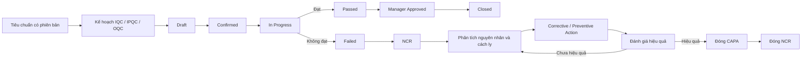

# Quality Management

Addon QMS độc lập cho **Odoo 19 Community**, quản lý tiêu chuẩn, kế hoạch kiểm tra, kết quả IQC/IPQC/OQC, NCR, CAPA và thiết bị đo.

| Thông tin | Giá trị |
|---|---|
| Tên ứng dụng | Quality Management |
| Tên kỹ thuật | `ps_quality` |
| Thư mục trong dự án | `custom_addons/ps_quality/` |
| Odoo | 19 Community |
| Phụ thuộc bắt buộc | `base`, `mail`, `product`, `web` |
| Dữ liệu mẫu | 30 hồ sơ minh họa, nạp theo lệnh; được đánh dấu `[MẪU]` |

## Quy trình chính



Kết quả được tính từ các chỉ tiêu bắt buộc và số lượng đạt/không đạt. Phiếu kiểm tra không đạt tự tạo NCR; quản lý có thể yêu cầu tái kiểm tra. Tiêu chuẩn đang áp dụng được giữ nguyên; thay đổi tạo phiên bản mới.

## Chức năng

- **Tiêu chuẩn chất lượng:** gắn sản phẩm, phiên bản, thời hạn hiệu lực, chỉ tiêu Min/Max, đơn vị đo, phương pháp và yêu cầu kiểm tra.
- **Kế hoạch:** loại IQC/IPQC/OQC, tần suất, khoảng lặp, cỡ mẫu, ngày kế tiếp và người kiểm tra; kế hoạch định kỳ tự dời ngày khi tạo phiếu.
- **Kiểm tra:** danh sách chỉ tiêu được sao vào phiếu; ghi số đo/đạt-không đạt, số lượng, disposition, tệp đính kèm và liên kết chứng từ.
- **NCR/CAPA:** nguồn lỗi, mức độ, containment, nguyên nhân gốc, người phụ trách, hạn xử lý, hành động, minh chứng và xác nhận hiệu quả. CAPA chưa hiệu quả có thể mở lại để làm tiếp.
- **Thiết bị đo:** mã, thông số, lịch sử hiệu chuẩn, ngày đến hạn, trạng thái ngoài sử dụng và activity nhắc hạn theo ngày cảnh báo đã cấu hình.
- **Dashboard & phân tích:** KPI theo công ty, danh sách, kanban, biểu đồ, pivot và báo cáo PDF cho Inspection, NCR, CAPA.
- **Theo dõi:** các model nghiệp vụ dùng chatter/activity; thay đổi trạng thái qua hành động có kiểm tra quyền và điều kiện.
- **Multi-company:** dữ liệu giới hạn theo công ty người dùng được phép truy cập.

## Phân quyền

| Nhóm | Phạm vi |
|---|---|
| Quality User | Tạo và xem phiếu kiểm tra của mình/được giao; xem tiêu chuẩn và kế hoạch đang áp dụng |
| Quality Inspector | Thực hiện kiểm tra, xử lý NCR/CAPA được giao và ghi nhận hiệu chuẩn |
| Quality Manager | Duyệt kết quả, quản lý kế hoạch, NCR/CAPA, thiết bị và hiệu chuẩn |
| Quality Administrator | Bao gồm quyền quản lý; tạo, kích hoạt, tạo phiên bản và ngừng áp dụng tiêu chuẩn |

Gán nhóm tại **Settings → Users & Companies → Users → Access Rights**. Nút thao tác có kiểm tra nhóm ở máy chủ; chỉ ẩn nút trên giao diện không được xem là kiểm soát quyền.

## Tích hợp ERP tùy chọn

Addon không khai báo phụ thuộc cứng tới các phân hệ nghiệp vụ. Khi model tương ứng đã được cài, phiếu có thể liên kết tới `purchase.order`, `mrp.production`, `sale.order`, `stock.picking` và `stock.lot`; thiết bị đo có thể liên kết `maintenance.equipment`.

Liên kết chứng từ không tự xác nhận phiếu kho, không tự nhập kho hoặc thay đổi lệnh sản xuất. Với OQC đạt và được duyệt, thao tác **Release OQC Transfer** ghi nhận phê duyệt chất lượng trên phiếu giao và mở chứng từ để bộ phận kho tiếp tục quy trình xuất hàng.

## Chạy với Docker Compose của dự án

Các lệnh chạy trong PowerShell. Từ repository, chuyển vào thư mục `odoo-trien-khai`:

```powershell
# Đặt addon trong thư mục custom_addons của dự án Odoo trước:
git clone https://github.com/patsoft-extra/ps_quality.git .\custom_addons\ps_quality
# Chạy các lệnh Docker Compose từ thư mục có docker-compose.yml
docker compose up -d
docker compose ps
```

Đảm bảo database `admin` đã được tạo. Cài addon lần đầu:

```powershell
docker compose run --rm --no-deps -T --entrypoint sh odoo -c 'odoo -c /etc/odoo/odoo.conf --db_host="$HOST" --db_port="$PORT" --db_user="$USER" --db_password="$PASSWORD" -d admin -i ps_quality --stop-after-init'
docker compose restart odoo
```

Sau đó mở `http://localhost:8570`, đăng nhập, vào **Apps → Update Apps List**, tìm **Quality Management** nếu menu chưa hiện, rồi gán nhóm Quality cho người dùng.

Nâng cấp sau khi sửa mã nguồn:

```powershell
docker compose run --rm --no-deps -T --entrypoint sh odoo -c 'odoo -c /etc/odoo/odoo.conf --db_host="$HOST" --db_port="$PORT" --db_user="$USER" --db_password="$PASSWORD" -d admin -u ps_quality --stop-after-init'
docker compose restart odoo
```

Chạy test workflow:

```powershell
docker compose run --rm --no-deps -T --entrypoint sh odoo -c 'odoo -c /etc/odoo/odoo.conf --db_host="$HOST" --db_port="$PORT" --db_user="$USER" --db_password="$PASSWORD" -d admin -u ps_quality --test-enable --test-tags /ps_quality --stop-after-init'
```

## Nạp 30 hồ sơ minh họa

Lệnh sau tạo 30 hồ sơ chính trong QMS: 5 tiêu chuẩn, 5 kế hoạch, 10 phiếu kiểm tra (8 đạt, 2 không đạt), 4 NCR, 3 CAPA, 2 thiết bị đo và 1 lần hiệu chuẩn. Sản phẩm, nhà cung cấp, chỉ tiêu và dòng kết quả được tạo kèm làm dữ liệu liên kết. Tất cả hồ sơ minh họa có nhãn `[MẪU]`; không dùng chúng như chứng từ thật. Script có thể chạy lại mà không nhân đôi dữ liệu.

```powershell
docker compose exec -T odoo sh -c 'odoo shell -c /etc/odoo/odoo.conf -d admin --db_host="$HOST" --db_port="$PORT" --db_user="$USER" --db_password="$PASSWORD" < /mnt/extra-addons/ps_quality/scripts/seed_sample_data.py'
```

Hồ sơ nằm trong ứng dụng **Quality Management**. Có thể xóa riêng hồ sơ `[MẪU]` sau khi kiểm tra giao diện; không cần xóa database hay filestore.

## Cấu trúc addon

```text
ps_quality/
├── data/       # Sequence và nhắc hạn hiệu chuẩn
├── models/     # Standard, plan, inspection, NCR/CAPA, equipment, dashboard
├── reports/    # QWeb PDF Inspection, NCR, CAPA
├── security/   # Nhóm quyền, ACL và record rules
├── tests/      # Kiểm thử luồng nghiệp vụ
└── views/      # Dashboard, form/list/kanban/search/graph/pivot và menu
```
