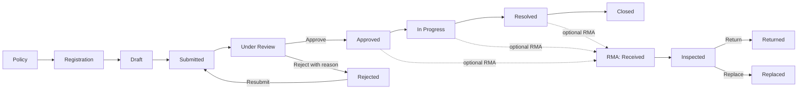

# Warranty Management

Addon quản lý bảo hành sản phẩm cho **Odoo 19 Community**. Module theo dõi chính sách, đăng ký theo sản phẩm/serial, yêu cầu bảo hành và quy trình RMA.

| Thông tin | Giá trị |
|---|---|
| Tên ứng dụng | Warranty Management |
| Tên kỹ thuật | `ps_warranty` |
| Thư mục addon | Gốc repository này; đặt tại `custom_addons/ps_warranty/` khi tích hợp vào Odoo |
| Phụ thuộc bắt buộc | `base`, `mail`, `product`, `web` |
| URL khi chạy bằng Compose | `http://localhost:8570` |

## Mục lục

- [Tổng quan](#tổng-quan)
- [Quy trình nghiệp vụ](#quy-trình-nghiệp-vụ)
- [Tính năng](#tính-năng)
- [Vai trò và quyền](#vai-trò-và-quyền)
- [Chạy cục bộ](#chạy-cục-bộ)
- [Dữ liệu minh họa](#dữ-liệu-minh-họa)
- [Kiểm tra](#kiểm-tra)
- [Tích hợp tùy chọn](#tích-hợp-tùy-chọn)
- [Cấu trúc mã nguồn](#cấu-trúc-mã-nguồn)

## Tổng quan

Overview hiển thị số lượng hồ sơ theo công ty đang chọn và có nút tạo nhanh. Tùy vai trò, người dùng có thể tạo Claim, Registration, RMA hoặc Policy ngay từ màn hình này.

| Phân hệ | Mục đích |
|---|---|
| Policy | Khai báo thời hạn, phạm vi sản phẩm, điều khoản và loại bảo hành |
| Registration | Gắn bảo hành với khách hàng, sản phẩm, serial/lô và ngày hiệu lực |
| Claim | Tiếp nhận, duyệt, sửa chữa/thay thế và ghi chi phí xử lý |
| RMA | Theo dõi hàng trả về, kiểm tra, sửa chữa, trả lại hoặc thay thế |
| Reports | Phân tích số lượng và chi phí claim theo trạng thái, sản phẩm, thời gian |

## Quy trình nghiệp vụ



Claim chỉ được gửi khi Registration đang hiệu lực và còn hạn. Hệ thống yêu cầu lý do khi từ chối, nội dung xử lý khi hoàn tất claim và kết quả kiểm tra khi hoàn tất bước kiểm tra RMA.

## Tính năng

- **Chính sách bảo hành:** thời hạn theo ngày/tháng/năm; áp dụng theo sản phẩm, nhóm sản phẩm hoặc toàn bộ sản phẩm; bảo hành miễn phí/có phí và phí kiểm tra.
- **Đăng ký bảo hành:** theo dõi khách hàng, sản phẩm, serial/lô, ngày mua, ngày kích hoạt và ngày hết hạn tự tính; tự tạo mã đăng ký.
- **Claim:** mức ưu tiên, người phụ trách, tệp đính kèm, ghi chú duyệt/từ chối, dòng sửa chữa/thay thế, chi phí, kết quả và thời gian xử lý.
- **RMA:** tự tạo mã, ghi nhận ngày nhận hàng, tình trạng, kết quả kiểm tra, sản phẩm thay thế và ngày đóng.
- **Overview:** KPI theo công ty hiện hành và nút tạo nhanh theo quyền người dùng.
- **Báo cáo:** danh sách, kanban, pivot, biểu đồ và phiếu claim PDF.
- **Nhắc hạn:** tác vụ định kỳ chuyển Registration đã quá hạn sang trạng thái hết hạn.

## Vai trò và quyền

| Vai trò | Quyền chính |
|---|---|
| Warranty User | Xem chính sách đang áp dụng và đăng ký; tạo, xem, cập nhật claim của mình |
| Warranty Officer | Quản lý Registration/RMA, tiếp nhận và xử lý claim, thêm dòng sửa chữa/thay thế |
| Warranty Manager | Quản lý Policy, duyệt/từ chối claim và quản lý dữ liệu trong các công ty được phép |
| Warranty Administrator | Bao gồm quyền của Warranty Manager |

Các nút tạo nhanh trên Overview được giới hạn theo vai trò. ACL và record rule cũng được áp dụng ở phía máy chủ.

## Chạy cục bộ

Các lệnh dưới đây chạy trong **PowerShell**, từ thư mục gốc repository.

### 1. Khởi động Odoo

Mở Docker Desktop, sau đó chạy:

```powershell
Set-Location .\odoo-trien-khai
docker compose up -d
docker compose ps
```

Chờ `db` ở trạng thái `healthy` và `odoo` ở trạng thái `Up`.

### 2. Cài module lần đầu

Chỉ chạy khi database `admin` chưa có addon:

```powershell
docker compose run --rm --no-deps -T --entrypoint sh odoo -c 'odoo -c /etc/odoo/odoo.conf --db_host="$HOST" --db_port="$PORT" --db_user="$USER" --db_password="$PASSWORD" -d admin -i base,product,ps_warranty --stop-after-init'
docker compose restart odoo
```

Đăng nhập tại [http://localhost:8570](http://localhost:8570). Gán nhóm **Warranty Administrator** cho người dùng quản trị tại **Settings → Users** nếu chưa được gán.

### 3. Mở ứng dụng

Chọn **Warranty Management** trên trang Apps. Vào **Overview** để xem KPI; dùng menu **Registrations**, **Claims**, **RMA**, **Policies** hoặc **Reports** để mở từng phần.

### 4. Cập nhật mã nguồn

Sau khi sửa addon, nâng cấp module rồi khởi động lại Odoo:

```powershell
docker compose run --rm --no-deps -T --entrypoint sh odoo -c 'odoo -c /etc/odoo/odoo.conf --db_host="$HOST" --db_port="$PORT" --db_user="$USER" --db_password="$PASSWORD" -d admin -u ps_warranty --stop-after-init'
docker compose restart odoo
```

Để dừng tạm mà giữ dữ liệu, chạy `docker compose stop`; chạy lại bằng `docker compose up -d`. Tránh `docker compose down -v` nếu cần giữ database và tệp đính kèm.

## Dữ liệu minh họa

Database `admin` của project hiện có **20 hồ sơ nghiệp vụ mẫu**: 10 Registration và 10 Claim, liên kết với 10 khách hàng, 10 sản phẩm và 3 Policy. Các hồ sơ mẫu có tiền tố `[MẪU]` hoặc `MẪU-`, có nhiều trạng thái claim để xem thử quy trình và không đại diện cho dữ liệu khách hàng thật.

Nạp thêm hoặc bổ sung các hồ sơ còn thiếu bằng script idempotent từ thư mục `odoo-trien-khai`:

```powershell
docker compose exec -T odoo sh -c 'odoo shell -c /etc/odoo/odoo.conf -d admin --db_host="$HOST" --db_port="$PORT" --db_user="$USER" --db_password="$PASSWORD" < /mnt/extra-addons/ps_warranty/scripts/seed_sample_data.py'
```

Script dùng lại các bản ghi mẫu có sẵn để tránh tạo trùng. Trong Odoo, mở **Registrations** hoặc **Claims** và tìm `MẪU-`.

## Kiểm tra

Chạy bộ test workflow bằng:

```powershell
docker compose run --rm --no-deps -T --entrypoint sh odoo -c 'odoo -c /etc/odoo/odoo.conf --db_host="$HOST" --db_port="$PORT" --db_user="$USER" --db_password="$PASSWORD" -d admin -u ps_warranty --test-enable --test-tags /ps_warranty:TestWarrantyWorkflow --stop-after-init'
```

Bộ test bao gồm thời hạn bảo hành, luồng claim, RMA, phân quyền và nút tạo nhanh trên Overview.

## Tích hợp tùy chọn

Sales, Purchase, Inventory, Documents và Field Service không phải phụ thuộc bắt buộc. Liên kết chứng từ, phiếu giao hàng thay thế và task Field Service chỉ hoạt động khi cài ứng dụng tương ứng và người dùng có quyền.

## Cấu trúc mã nguồn

```text
.
├── __manifest__.py
├── data/       # sequence và tác vụ định kỳ
├── models/     # policy, registration, claim, RMA, dashboard
├── reports/    # phiếu claim PDF
├── scripts/    # nạp dữ liệu minh họa
├── security/   # nhóm, ACL và record rules
├── tests/      # kiểm tra workflow và quyền
└── views/      # giao diện danh sách, form, kanban và báo cáo
```

Xem [hướng dẫn triển khai toàn project](../../WARRANTY_IMPLEMENTATION.md) và [README Docker Compose](../../README.md) để biết thêm cấu hình môi trường.
